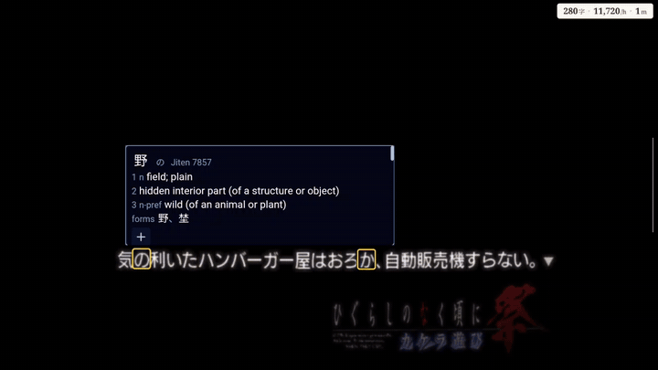
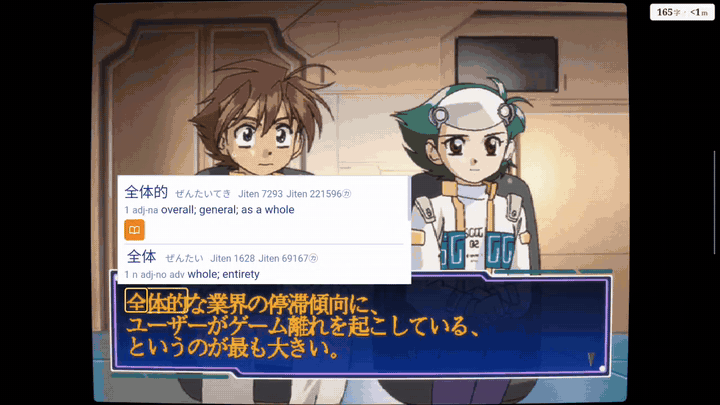
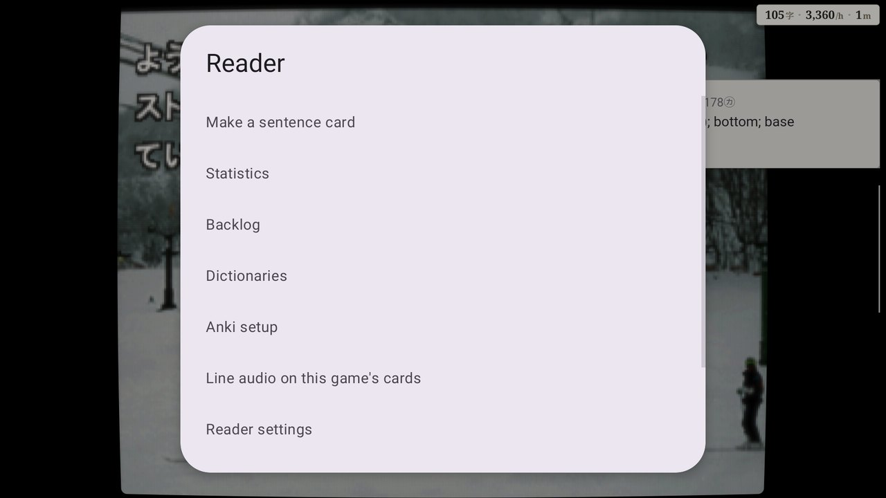

<h1 align="center">Furoshiki</h1>

Furoshiki is an emulator frontend with lookup and sentence mining built in, for Japanese games on
Windows and Android.

Each console's emulator is built into Furoshiki as a *core*, as in RetroArch, so one program, one
library and one set of settings covers every console. The reading tools are the same across all
of them.

Each supported game has a script, written with AI, that reads its text straight from memory, along
with where every character sits on the screen. So there's no OCR and no texthooker window. You
hover a word in the game itself, a Yomitan-style popup opens on it, and one button makes an Anki
card with the sentence, a screenshot and the audio.

| Console | Core | Windows | Android |
| --- | --- | --- | --- |
| PlayStation | DuckStation | ✓ | ✓ |
| PlayStation 2 | PCSX2 (ARMSX2 on Android) | ✓ | ✓ |
| PSP | PPSSPP | ✓ | ✓ |
| Dreamcast | Flycast | ✓ | ✓ |
| Nintendo 3DS | Azahar | ✓ | ✓ |
| PS Vita | Vita3K | ✓ | ✓ |

**A CRT picture** for every console but the Vita, with sliders and ready-made looks (*Settings,
Furoshiki, CRT effect*): scan lines, the phosphor's pattern, the curved glass, and a glow that
spreads off what is bright into the dark beside it, as a tube's glass spreads light. On Windows
with an HDR screen, its HDR row lets the lit phosphor shine brighter than white (the Dreamcast,
PSP and PS2 cores).

## New in Furoshiki 3

- **The shelf.** Every title stands as a spine with its box art; the one in hand opens to its
  cover, what you have read of it and one key that plays it. Type and hairlines, in four themes
  (Kon, Mono, Paper, Solarized). Android has the same look, laid out for folding phones and for
  handhelds with two displays.
- **Settings as pages**, by what they are for: Reading, Popup, Cards, Sources, Consoles,
  Controller, Keys. Each page shows the few rows most people change, with the rest behind *More*.
  `/` finds a setting by name, a small square marks what you changed and Backspace puts it back.
  Everything works by keyboard, controller or mouse alone.
- **Cards**: the lines before as context, the audio trimmed to the voice, one card from several
  lines of the backlog, a card of just the word (Ctrl+W), and the last card taken back (Ctrl+Z).
  *Explain* (Ctrl+E) gives a line's translation and grammar from Claude Code on your own computer,
  if you have it.
- **The popup** has a design page with a live preview, and an opacity slider so the game shows
  through it.
- **Other sources** (*Add a title*): besides a console's disc or file, a PC game read by a text
  hook, or lines from a texthooker's WebSocket or the clipboard.
- **Widescreen** (16:9, 21:9, 32:9) for the PS2 games that have a checked recipe: the 3D is drawn
  wide and the 2D keeps its shape, never stretched.
- **Android**: on-screen buttons and a stick, and a menu over the game with savestate slots, disc
  change, fast forward, skip to the next choice, patches and cheat codes; a game pinned to the
  home screen.

## What it looks like

The pictures below were taken before Furoshiki 3: the games look the same, the menus do not.

All pictures are of Furoshiki for Android on an AYN Thor, the games' own text read as it comes up.

**Higurashi no Naku Koro ni Matsuri** (PS2), each part of the story as it comes up:

**Segagaga** (Dreamcast), the president's speech in its message window:

**Shin Megami Tensei IV** (3DS), on a device with two displays: the lower screen goes to the second one.

 

**The Legend of Heroes: Trails in the Sky FC Evolution** (Vita), the speaker's name with each line:

<table>
<tr><td> <b>Ever17</b> (PS2)</td>
<td> <b>Tokimeki Memorial Forever with You</b> (PSP)</td></tr>
</table>

**The menus.** The library, one page a console, each game with its box art and what you have
read of it; the consoles' settings, in layers (all consoles, one console, one game); the menu of a
game in play, the reading menu, and the backlog of what was read.

<table>
<tr><td></td>
<td></td></tr>
<tr><td></td>
<td></td></tr>
<tr><td colspan="2" align="center"></td></tr>
</table>

## Supported games

A game is read through its **game script**, a small Lua file for that game's version. You install
scripts inside Furoshiki from each console's list (*Game scripts*), and it checks every file
against the list before installing it. A game with no script still plays, just without the
reading tools. Scripts are for the Japanese release of each game.

<b>PlayStation</b> (4 games)

| Game | Title | What is read |
| --- | --- | --- |
| Kamaitachi no Yoru | かまいたちの夜 特別篇 | Story text and choices |
| Double Cast | ダブルキャスト | Film subtitles and choices |
| Aconcagua | アコンカグア | Message windows |
| Gakkou de Atta Kowai Hanashi S | 学校であった怖い話S | Story text and choices |

<b>PlayStation 2</b> (11 games)

| Game | Title | What is read |
| --- | --- | --- |
| Ever17 | Ever17 -the out of infinity- Premium Edition | Story text with speakers, choices |
| Never7 | Never7 -the end of infinity- | Story text with speakers, choices |
| Remember11 | Remember11 -the age of infinity- | Story text with speakers, choices |
| CLANNAD | CLANNAD | Story text with speakers, choices |
| Higurashi no Naku Koro ni Matsuri | ひぐらしのなく頃に祭 カケラ遊び | Story text with speakers and furigana |
| Amagami | アマガミ | Message window with furigana |
| EVE burst error PLUS | EVE burst error PLUS | Message window |
| Utawarerumono | うたわれるもの 散りゆく者への子守唄 | Message window with speakers |
| Shadow Hearts | シャドウハーツ | Scene and talk windows with speakers |
| Dragon Quest V | ドラゴンクエストV 天空の花嫁 | Message window |
| Silent Hill 2 | サイレントヒル2 | Subtitles |

<b>PSP</b> (10 games)

| Game | Title | What is read |
| --- | --- | --- |
| Steins;Gate | STEINS;GATE | Message window with speakers and furigana, phone mails |
| Chaos;Head Love Chu Chu! | CHAOS;HEAD らぶChu☆Chu! | Message window with furigana |
| 428: Shibuya Scramble | 428 ～封鎖された渋谷で～ | Story text with furigana, TIPS, choices |
| Danganronpa | ダンガンロンパ 希望の学園と絶望の高校生 | Message box with speakers |
| Trails in the Sky FC | 英雄伝説 空の軌跡FC | Talk windows with speakers |
| Tokimeki Memorial Forever with You | ときめきメモリアル forever with you | Message window with speakers, choices |
| Grisaia no Kajitsu | グリザイアの果実 -LE FRUIT DE LA GRISAIA- | Message window with speakers, choices |
| Da Capo I&II Plus Situation Portable | D.C.I&II P.S.P. | Message window with speakers and furigana |
| My Merry May with be | My Merry May with be | Story text with speakers |
| Dunamis 15 | DUNAMIS15 | Message window with speakers and furigana |

<b>Dreamcast</b> (8 games)

| Game | Title | What is read |
| --- | --- | --- |
| Shenmue II (Windows only for now) | シェンムーII | Subtitles |
| What's Shenmue | What's シェンムー 〜湯川(元)専務をさがせ〜 | Subtitles |
| Sakura Taisen | サクラ大戦 | Message window, timed choices |
| Segagaga | セガガガ | Message window |
| Rent a Hero No.1 | レンタヒーロー No.1 | Message window |
| Kita e. White Illumination | 北へ。White Illumination | Message window |
| July | July | Message window with speakers, choices |
| Ayanami Raising Project | 新世紀エヴァンゲリオン 綾波育成計画 | Message window |

<b>Nintendo 3DS</b> (1 game)

| Game | Title | What is read |
| --- | --- | --- |
| Shin Megami Tensei IV | 真・女神転生IV | Dialogue, narration and choices |

<b>PS Vita</b> (1 game)

| Game | Title | What is read |
| --- | --- | --- |
| Trails in the Sky FC Evolution | 英雄伝説 空の軌跡 FC Evolution | Talk windows with speakers |

A few more games are supported but can't be listed here: their scripts need a table made from
the game's own files, which can't be published.

## Setting up

Nothing from a console maker is included. You bring your own games, dumped from discs or
cartridges you own, plus:

| Console | You need | Windows | Android |
| --- | --- | --- | --- |
| PlayStation | The BIOS (e.g. `SCPH-5500.bin`) | `program\consoles\ps1\system` | `Games/BIOS/PS1` |
| PlayStation 2 | The BIOS | `program\consoles\ps2\system` | `Games/BIOS/PS2` |
| PSP | Nothing | | |
| Dreamcast | Nothing (a BIOS of your own is optional) | `program\consoles\dc\system\dc\dc_boot.bin` | |
| Nintendo 3DS | Decrypted games; keys only where a game asks for them | `program\consoles\3ds\system` | |
| PS Vita | The firmware (`PSVUPDAT.PUP`, plus `PSP2UPDAT.PUP` if you have it) | `program\consoles\psvita\system` | `Games/BIOS/Vita` |

**Windows:** the folders above are in `%LOCALAPPDATA%\Furoshiki`. Add your game folders in the
program.

**Android:** put games in a `Games` folder on the device or SD card, one subfolder per console
(`Games/PS2`, `Games/PSP`...), or add your own folders in Settings.

**Dictionaries:** Yomitan-format zips. On Windows you import them in the program. On Android, put
them in `Games/Dictionaries` and they're imported at first start.

**Anki:** cards go to Anki through AnkiConnect on Windows, and to AnkiDroid on Android.

## Download

From the [latest release](../../releases/latest):

- **Windows** (`Furoshiki-<version>-windows.zip`): unzip it anywhere and run `Furoshiki.exe`. The
  PS2 and Vita cores need the
  [Microsoft Visual C++ Redistributable (x64)](https://aka.ms/vs/17/release/vc_redist.x64.exe), as
  PCSX2 does.
- **Android** (`Furoshiki-<version>-android.apk`): Android 10 or later, 64-bit ARM. Install it by
  hand, and allow it to see all files when it asks, so it can read your games where they are.

Then install a console's game scripts from *Game scripts*, and the games they read appear in your
library.

## Building from source

| Folder | What it is |
| --- | --- |
| `home/` | Furoshiki for Windows and Linux |
| `android/` | Furoshiki for Android |
| `shared/` | The lookup and mining layer, used everywhere |
| `cores/` | The interface between Furoshiki and the cores |
| `station/`, `pcsx2/`, `armsx2/`, `ppsspp/`, `flycast/`, `azahar/`, `vita3k/` | Each emulator, with its core and its game scripts |

Fetch an emulator's third-party code with `git submodule update --init --recursive -- <folder>`.
Then:

- **A core:** `<emulator>/tools/reader/build-core-windows.sh`, `build-core-android.sh` or
  `build-core.sh` (Linux)
- **Windows:** `HOME_PUBLIC=1 home/tools/build-windows.sh`, then
  `HOME_PUBLIC=1 home/tools/package-windows.sh`
- **Android:** `android/tools/build.sh`

The scripts build on Linux and find their compilers through each folder's `tools/reader/env.sh`,
which names the toolchains they expect.

## Licence

Furoshiki and the cores are free software under the **GNU General Public License, version 3**
(`COPYING`; the folders `home/`, `cores/` and `shared/` each carry it too). Each emulator keeps
its own licence and its authors' notices in its folder. `NOTICES.md` lists what is in the
packages and under which terms, including why Flycast's code, whose `LICENSE` file is the
GPLv2 text, is distributed here under version 3.

This project is not affiliated with Sony, Sega, Nintendo, or the emulators' projects. Please
do not report its problems to them.
