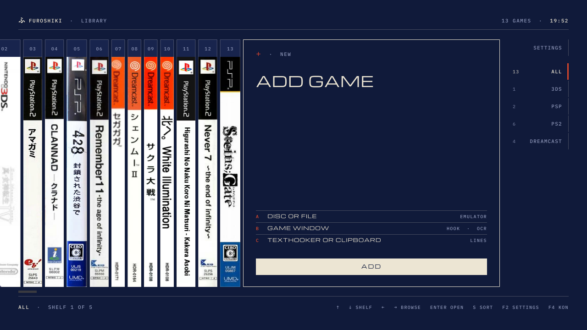
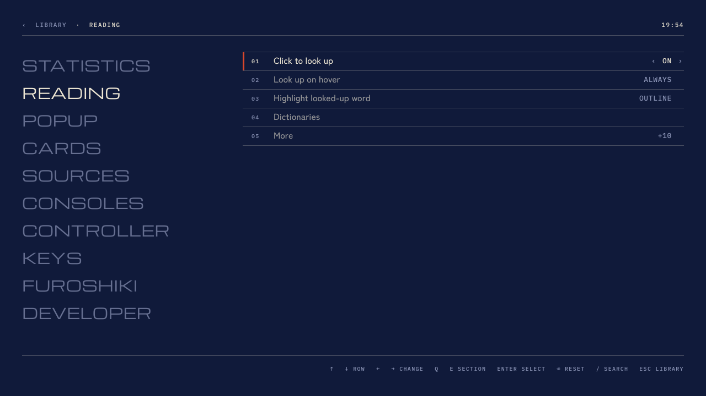
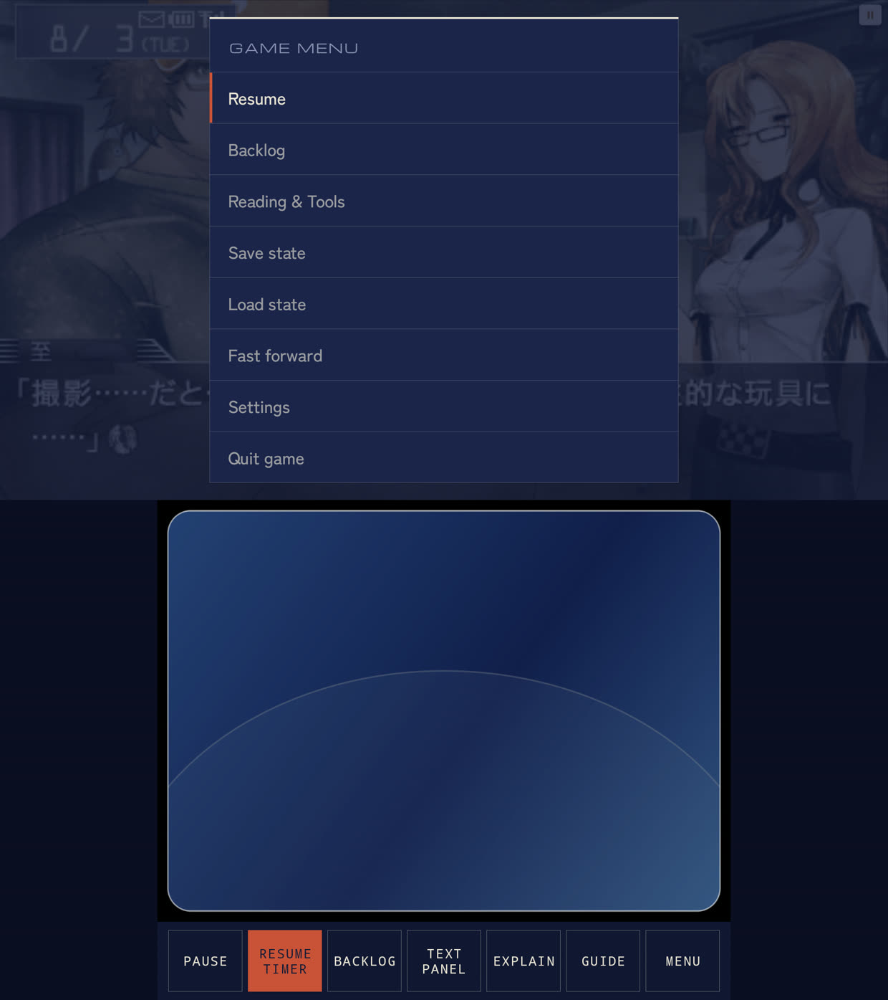
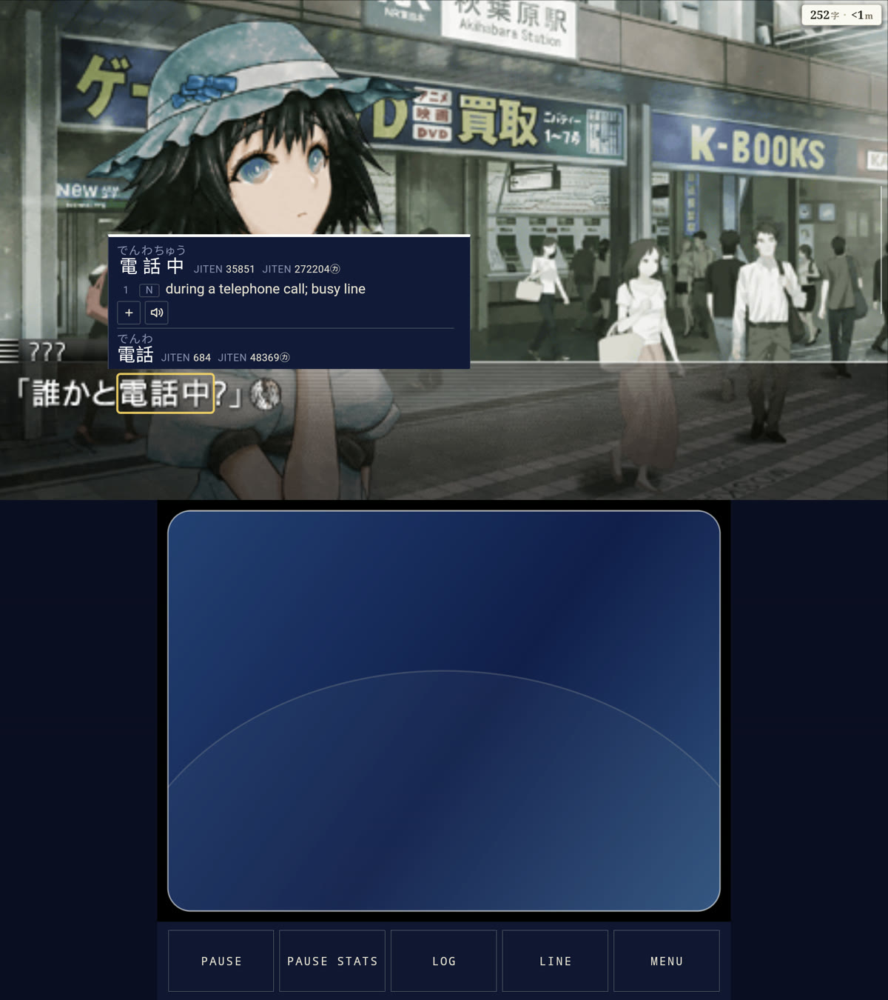
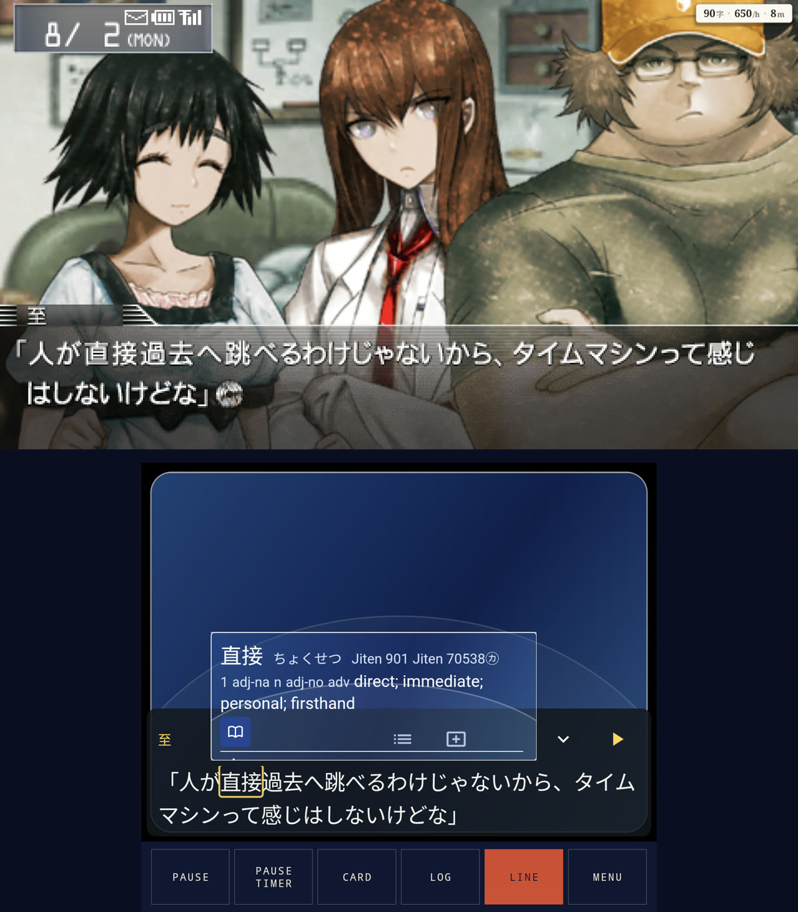

<h1 align="center">Furoshiki</h1>

<b>A game launcher with sentence mining built in, for Japanese games.</b> 
Point at a word in the game's own text to look it up, then add it to Anki. For Windows and Android.

<b>Latest releases:</b>
<a href="../../releases/download/v0.2.6/Furoshiki-0.2.6-android.apk">Android 0.2.6</a> ·
<a href="../../releases/download/v0.2.3/Furoshiki-0.2.3-windows.zip">Windows 0.2.3</a> ·
<a href="../../releases/download/v0.2.3/Furoshiki-ocr-helper.zip">OCR helper (Windows)</a> ·
<a href="../../releases">all releases</a>

Remember11 (PS2) on Windows. The frame around the game is the optional CRT filter.

Furoshiki keeps your Japanese games in one library and plays them itself: emulators for seven
consoles are built in (six on Windows). While you play, it reads the game's text, so you can look a word up where it stands
on the screen and send the sentence to Anki with a screenshot and the line's audio. You do not
need a second window beside the game, and nothing is copied and pasted.

A game's text is read in one of three ways:

| How | What you get | Where |
| --- | --- | --- |
| A **game script** written for that game | The exact text from the game's memory, and where each character is drawn. You point at the game's own text, as in the picture above. | [38 games](#supported-games), Windows and Android |
| **OCR** of the picture | The text as an OCR engine reads it. Good for any game, with the odd misread character. | Windows and Android |
| A **text hook**, or lines from another tool | The exact text of a PC game, shown in a strip at the edge of the screen. | Windows |

## Consoles

| Console | Emulator | Windows | Android |
| --- | --- | --- | --- |
| PlayStation | [DuckStation](https://github.com/stenzek/duckstation) | Yes | Yes |
| PlayStation 2 | [PCSX2](https://github.com/PCSX2/pcsx2) ([ARMSX2](https://github.com/ARMSX2/ARMSX2) on Android) | Yes | Yes |
| PSP | [PPSSPP](https://github.com/hrydgard/ppsspp) | Yes | Yes |
| Dreamcast | [Flycast](https://github.com/flyinghead/flycast) | Yes | Yes |
| Nintendo 3DS | [Azahar](https://github.com/azahar-emu/azahar) | Yes | Yes |
| PS Vita | [Vita3K](https://github.com/Vita3K/Vita3K) | Yes | Yes |
| Nintendo DS | [melonDS](https://github.com/melonDS-emu/melonDS) | Not yet | Yes |

Each emulator is built into Furoshiki as a core, the way RetroArch does it, so there is nothing
else to install. Settings can be made for all consoles, for one console or for one game.

## Download

The Windows and Android versions are released separately, so use these links instead of the
newest release page, which has only the files that changed.

| File | For | Notes |
| --- | --- | --- |
| [Furoshiki-0.2.3-windows.zip](../../releases/download/v0.2.3/Furoshiki-0.2.3-windows.zip) | Windows 10 or 11, 64-bit | Unzip it anywhere and run `Furoshiki.exe`. |
| [Furoshiki-0.2.6-android.apk](../../releases/download/v0.2.6/Furoshiki-0.2.6-android.apk) | Android 10 or later, 64-bit ARM | Open the file to install it, and allow installs from your browser or file manager when Android asks. |
| [Furoshiki-ocr-helper.zip](../../releases/download/v0.2.3/Furoshiki-ocr-helper.zip) | Windows, optional | Only if you want OCR on Windows. See [OCR on Windows](#ocr-on-windows). |

On Windows, the PS2 and Vita cores need the
[Microsoft Visual C++ Redistributable (x64)](https://aka.ms/vs/17/release/vc_redist.x64.exe). The
dictionary popup is drawn with Microsoft's WebView2 runtime, which Windows 11 and an up-to-date
Windows 10 already have. Without it the popup still works, in a plainer look.

There is no Linux download. The Windows program also builds for Linux
([Building from source](#building-from-source)).

Nothing from a console maker is included. You bring your own games, dumped from discs or
cartridges you own, and the BIOS files listed below.

## Setting up on Windows

1. Start `Furoshiki.exe`. It offers to download [Jitendex](https://jitendex.org), a free
   dictionary (39 MB). You can choose your own Yomitan dictionary zips instead, or add more later
   in Settings › Reading › Dictionaries.
2. If Anki is open with the [AnkiConnect](https://ankiweb.net/shared/info/2055492159) add-on,
   Furoshiki offers to set up cards. It uses a deck and note type you already have: the deck with
   "mining" in its name (or the first that is not Default), and the note type most of that deck's
   notes use. It fills the fields it recognises by name. Settings › Cards › Anki setup changes
   any of this.
3. Put the BIOS files your consoles need in the folders in the table below.
4. Choose **Add game** at the end of the shelf, then *Disc or file*, and pick the folder your
   games are in.
5. Start a game. To install its script, open the Quick menu (F1 or right-click), choose
   *Game scripts…*, install the script, and start the game again.

| Console | You need | Folder in `%LOCALAPPDATA%\Furoshiki` |
| --- | --- | --- |
| PlayStation | A BIOS, such as `SCPH-5500.bin` | `program\consoles\ps1\system` |
| PlayStation 2 | A BIOS | `program\consoles\ps2\system` |
| PSP | Nothing | |
| Dreamcast | Nothing. Your own `dc_boot.bin` is optional. | `program\consoles\dc\system\dc` |
| Nintendo 3DS | Decrypted games. `aes_keys.txt` only if a game asks for it. | `program\consoles\3ds\system` |
| PS Vita | The firmware: `PSVUPDAT.PUP`, and `PSP2UPDAT.PUP` if you have it | `program\consoles\psvita\system` |

## Setting up on Android

1. Install the APK and open Furoshiki. Tap *Allow file access* when it asks, so it can find your
   games where they are.
2. Setup asks where your games are. Choose one folder, or add one after another if each console
   has its own. A `Games` folder on the device or its SD card is found without asking.
3. Put BIOS files in `Games/BIOS/PS1`, `Games/BIOS/PS2` and `Games/BIOS/Vita`. The other consoles
   need none.
4. Put Yomitan dictionary zips in `Games/Dictionaries`. They are imported the next time
   Furoshiki starts.
5. Install [AnkiDroid](https://github.com/ankidroid/Anki-Android) if you want cards. Furoshiki
   asks for its permission once, then uses your mining deck and its note type, as on Windows.

Every game found is listed, and the scripts for supported games are downloaded for you. Box art
is fetched too. *Game scripts* in Settings shows each console's list.

## Reading a game

A game's page on Windows: what you have read of it, and the character names that come with its script.

On Windows you look a word up by pointing at it or clicking it. On Android you tap it. The popup
shows entries from your dictionaries, with the plain form of an inflected word found for you. A
supported game also has its characters' names and their readings, which are looked up before the
general dictionaries.

A card has the word, the sentence, a screenshot and the line's audio, which can be trimmed to the
voice. On Android the card buttons are in the popup. On Windows these are the keys:

| Key | What it does |
| --- | --- |
| Ctrl+D | Add a card for the sentence |
| Ctrl+W | Add a card for the word you looked up |
| Ctrl+Z | Undo the last card |
| Ctrl+H | Open the backlog |
| Ctrl+G | Pause the game |
| Ctrl+T | Pause the reading timer |
| Ctrl+N | Skip to the next choice |
| F1 or right-click | Quick menu |
| Esc | Game menu |
| F2 | Settings |

The backlog keeps every line you have read, with its speaker where the game gives one, and you
can make a card from several lines of it. For each game Furoshiki counts the characters you read,
the time, and your speed in characters per hour. The count stays on your device.

Furoshiki was developed with a Steam Controller, whose trackpad moves the pointer with no setup.
With another controller, give a button the *Pointer (hold)* action in Settings › Controller ›
Button mapping. While you hold that button, the sticks move the pointer.

## Games without a script

A console game with no script still plays, and can be read by OCR. PC games are read by a text
hook or by OCR.

### On Windows

**Add game**, at the end of the shelf, asks where the game is:

| Choice | Use it for | Read by |
| --- | --- | --- |
| Disc or file | A console game | Its script, or OCR if it has none |
| Game window | A PC game that is running | A text hook, or OCR if no hook fits |
| Texthooker or clipboard | Any other source of text | Lines from a texthooker's WebSocket, or text copied to the clipboard |

For a PC game Furoshiki starts the hook itself. It can use
[Agent](https://github.com/0xDC00/agent) scripts, LunaHook or
[Textractor](https://github.com/Artikash/Textractor). These are their authors' own projects. They
are not part of this repository, and Furoshiki downloads one only when you choose it.

Text read by a hook or sent as lines appears in a strip at the edge of the screen, and you look
words up there. With OCR you can also look words up on the game's window. Cards, the backlog and
the reading count work as they do for a game with a script.

### OCR on Windows

OCR needs the OCR helper, a separate download because it comes with its own copy of Python and an
OCR model of about 1 GB. Unzip `Furoshiki-ocr-helper.zip` into Furoshiki's folder and run
`install.cmd`. It needs no administrator rights. Furoshiki starts and stops the helper by itself.
[The helper's own README](home/ocr-helper/README.md) has the details.

You choose the engine. [meikiocr](https://github.com/rtr46/meikiocr) is the default; OneOCR and
Chrome Screen AI also read on your computer, while Google Lens sends each text area to Google.

To read a console game by OCR, open the game menu (Esc) and choose *Use OCR for this game*, then
*Set text area…*. A game can have several text areas, and an area can be read only when you press
Ctrl+Shift+R, which suits a menu or a status screen.

### OCR on Android

On Android, OCR needs nothing extra. It runs on the device with meikiocr and sends nothing
anywhere. Google Lens reads better and sends each text area to Google. Choose between them in
Settings › *OCR engine*.

## The library

Your games stand on a shelf. The selected one opens to its cover and shows what you have read of
it. Enter opens its page, and Enter again plays it.

On Windows, F on a game looks for its box art: Steam's art for a Steam game, and
[VNDB](https://vndb.org)'s cover and spine scans for others. The pictures are kept in
`%LOCALAPPDATA%\Furoshiki\program\art`, and you can put your own there as `<ID>.cover.jpg` and
`<ID>.spine.jpg`, with the ID shown on the game's page. A game with no spine picture gets one
drawn in its console's style. On Android, covers are fetched without asking.

F4 changes the theme. From the top left: Kon, Paper, Mono and Solarized.

## Picture

A CRT filter is available for every console except the PS Vita. It has scan lines, a phosphor
pattern and curved glass, with sliders for each and ready-made looks. It is on in the picture at
the top of this page. On Windows with an HDR screen, the lit phosphor can be brighter than white
on the Dreamcast, PSP and PS2.

Each core's own picture settings, such as upscaling, can be set for all consoles, one console or
one game.

## Settings

F2 opens the settings on Windows. Each page shows a few rows and keeps the others behind *More*.
Press `/` to search for a setting by name, and Backspace to reset the selected row. Everything
can be reached with the keyboard, the mouse or a controller alone.

The popup has its own page, with several looks, an opacity slider so the game shows through, and
a place for your own CSS.

## On Android

Furoshiki works by touch or with a controller. Where the device has no buttons it shows a stick
and buttons over the game, and a game can be pinned to the home screen.

The game menu has save states, fast forward and skip to the next choice.

### Handhelds with two displays

The pictures below are from an AYN Thor. The shelf is on the upper display, with a page for each
console. The lower display shows the selected game and the button that plays it.

A tick on a spine means the game is read by its script.

In a game, the lower display is where you look words up. For a 3DS or DS game it is the console's
lower screen instead. There are two ways to look a word up.

With the trackpad, you move a pointer over the game's own text. The word under the pointer is
looked up, and the popup opens over the game.

With **Line**, the sentence is also shown below the trackpad. Tap a word in it, and the popup
opens on the lower display, so nothing covers the game.

**Pause** stops the game, **Pause stats** stops the reading timer, **Log** opens the backlog and
**Menu** opens the game menu. In the popup, `+` adds the card and the speaker button adds it with
the line's audio.

### GameNative and other apps

[GameNative](https://github.com/utkarshdalal/GameNative) runs Windows games from Steam and other
stores on Android. Furoshiki can read those games, and games in any other app, by OCR. It starts
the game, asks once for permission to capture the screen, and reads the text. You look words up
over the game, or in the line on a second display. If the screen has much on it besides the
game's text, **Area** marks where the text is.

Glasses on a spine mean the game is read by OCR. A question mark means OCR is not set up for it yet.

To have your GameNative games listed and started from Furoshiki:

1. In GameNative, open Settings › Interface › Frontend Sync, turn it on and choose a folder. A
   new one such as `Games/GameNative` is a good choice.
2. In Furoshiki, choose the same folder. Setup asks for it, and Settings has
   *Add GameNative folder*.

The games then have a GameNative shelf. A game from any other app is added with **Add a game**:
choose the app and give the game a name.

## Supported games

A game script is a small Lua file for one release of one game, so check the ID. Scripts are for
the Japanese release. Furoshiki downloads scripts from the lists in this repository and checks
each file against its list before installing it.

<b>PlayStation</b> (4 games)

| Game | Japanese title | ID | What is read |
| --- | --- | --- | --- |
| Kamaitachi no Yoru | かまいたちの夜 特別篇 | SLPS-01794 | Story text and choices |
| Double Cast | ダブルキャスト | SCPS-10053, SCPS-10054 | Film subtitles and choices |
| Aconcagua | アコンカグア | SCPS-10131, SCPS-10132 | Message windows |
| Gakkou de Atta Kowai Hanashi S | 学校であった怖い話S | SLPS-00404 | Story text and choices |

<b>PlayStation 2</b> (11 games)

| Game | Japanese title | ID | What is read |
| --- | --- | --- | --- |
| Ever17 | Ever17 -the out of infinity- Premium Edition | SLPM-65421 | Story text with speakers, choices |
| Never7 | Never7 -the end of infinity- | SLPS-25256 | Story text with speakers, choices |
| Remember11 | Remember11 -the age of infinity- | SLPM-65550 | Story text with speakers, choices |
| CLANNAD | CLANNAD | SLPM-66302 | Story text with speakers, choices |
| Higurashi no Naku Koro ni Matsuri | ひぐらしのなく頃に祭 カケラ遊び | SLPM-66913 | Story text with speakers and furigana |
| Amagami | アマガミ | SLPS-25918 | Message window with furigana, choices |
| EVE burst error PLUS | EVE burst error PLUS | SLPM-65320 | Message window |
| Utawarerumono | うたわれるもの 散りゆく者への子守唄 | SLPS-25679 | Message window with speakers |
| Shadow Hearts | シャドウハーツ | SLPS-25041 | Scene and talk windows with speakers |
| Dragon Quest V | ドラゴンクエストV 天空の花嫁 | SLPM-65555 | Message window |
| Silent Hill 2 | サイレントヒル2 | SLPM-65051 | Subtitles |

<b>PSP</b> (10 games)

| Game | Japanese title | ID | What is read |
| --- | --- | --- | --- |
| Steins;Gate | STEINS;GATE | ULJM05887 | Message window with speakers and furigana, phone mails |
| Chaos;Head Love Chu Chu! | CHAOS;HEAD らぶChu☆Chu! | ULJM05821 | Message window with furigana |
| 428: Shibuya Scramble | 428 ～封鎖された渋谷で～ | ULJS00219 | Story text with furigana, TIPS, choices |
| Danganronpa | ダンガンロンパ 希望の学園と絶望の高校生 | NPJH50372 | Message box with speakers |
| Trails in the Sky FC | 英雄伝説 空の軌跡FC | ULJM05170 | Talk windows with speakers and furigana, choices |
| Tokimeki Memorial Forever with You | ときめきメモリアル forever with you | ULJM05078 | Message window with speakers, choices |
| Grisaia no Kajitsu | グリザイアの果実 -LE FRUIT DE LA GRISAIA- | ULJM06232, ULJM06233 | Message window with speakers, choices |
| Da Capo I&II Plus Situation Portable | D.C.I&II P.S.P. | ULJM05718, ULJM05719 | Message window with speakers and furigana, choices |
| My Merry May with be | My Merry May with be | ULJM05603 | Story text with speakers, choices |
| Dunamis 15 | DUNAMIS15 | ULJM06119 | Message window with speakers and furigana |

<b>Dreamcast</b> (8 games)

| Game | Japanese title | ID | What is read |
| --- | --- | --- | --- |
| Shenmue II (Windows only for now) | シェンムーII | HDR-0164 | Subtitles |
| What's Shenmue | What's シェンムー 〜湯川(元)専務をさがせ〜 | 6107179 | Subtitles |
| Sakura Taisen | サクラ大戦 | HDR-0072 | Message window, timed choices |
| Segagaga | セガガガ | HDR-0151 | Message window |
| Rent a Hero No.1 | レンタヒーロー No.1 | HDR-0074 | Message window |
| Kita e. White Illumination | 北へ。White Illumination | T14301M | Message window |
| July | July | T35401M | Message window with speakers, choices |
| Ayanami Raising Project | 新世紀エヴァンゲリオン 綾波育成計画 | T46303M | Message window |

<b>Nintendo 3DS</b> (2 games)

| Game | Japanese title | ID | What is read |
| --- | --- | --- | --- |
| Shin Megami Tensei IV | 真・女神転生IV | 0004000000088A00 | Dialogue, narration and choices |
| Professor Layton vs. Phoenix Wright: Ace Attorney | レイトン教授VS逆転裁判 | 0004000000078B00 | Dialogue with speakers, narration, subtitles, puzzle texts |

<b>Nintendo DS</b> (2 games, Android)

| Game | Japanese title | ID | What is read |
| --- | --- | --- | --- |
| Wish Room | ウィッシュルーム 天使の記憶 | AWIJ | Message windows with speakers, choices |
| 999: Nine Hours, Nine Persons, Nine Doors | 極限脱出 9時間9人9の扉 | BSKJ | Novel text and talk windows with speakers, escape rooms, choices, file pages |

<b>PS Vita</b> (1 game)

| Game | Japanese title | ID | What is read |
| --- | --- | --- | --- |
| Trails in the Sky FC Evolution | 英雄伝説 空の軌跡 FC Evolution | PCSG00488 | Talk windows with speakers and furigana |

## Help

Report a problem or ask a question in [Issues](../../issues). Please do not report Furoshiki's
problems to the emulators' projects. Furoshiki is not affiliated with them, or with Sony, Sega or
Nintendo.

## Building from source

| Folder | What it is |
| --- | --- |
| `home/` | Furoshiki for Windows and Linux |
| `android/` | Furoshiki for Android |
| `shared/` | The lookup and card code both use |
| `home/ocr-helper/` | The OCR helper (Python). `package.sh` makes its zip. |
| `cores/` | The interface between Furoshiki and the cores |
| `station/`, `pcsx2/`, `armsx2/`, `ppsspp/`, `flycast/`, `azahar/`, `vita3k/`, `melonds/` | One emulator each, with its core and its game scripts |

The build scripts run on Linux, for all three targets. Each emulator's `tools/reader/env.sh`
lists the compilers and toolkits the scripts expect.

1. Fetch an emulator's third-party code:
   `git submodule update --init --recursive -- <folder>`
2. Build its core: `<emulator>/tools/reader/build-core-windows.sh`, `build-core-android.sh`, or
   `build-core.sh` for Linux.
3. Build Furoshiki. For Windows: `HOME_PUBLIC=1 home/tools/build-windows.sh`, then
   `HOME_PUBLIC=1 home/tools/package-windows.sh`. For Android: `android/tools/build.sh`.

## Licence

Furoshiki and the cores are free software under the
[GNU General Public License, version 3](COPYING). The folders `home/`, `cores/` and `shared/`
each have a copy. Each emulator keeps its own licence and its authors' notices in its folder.
[NOTICES.md](NOTICES.md) lists what is in the packages and under which terms. It also explains
why Flycast's code, whose `LICENSE` file is the GPLv2 text, is distributed here under version 3.
