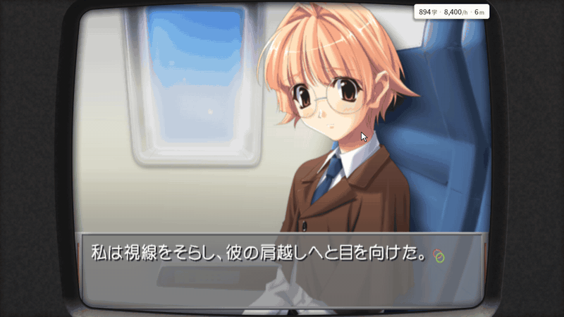
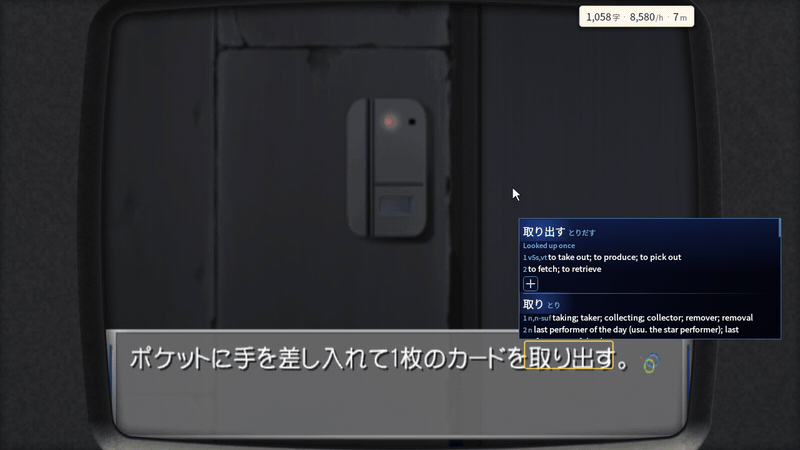
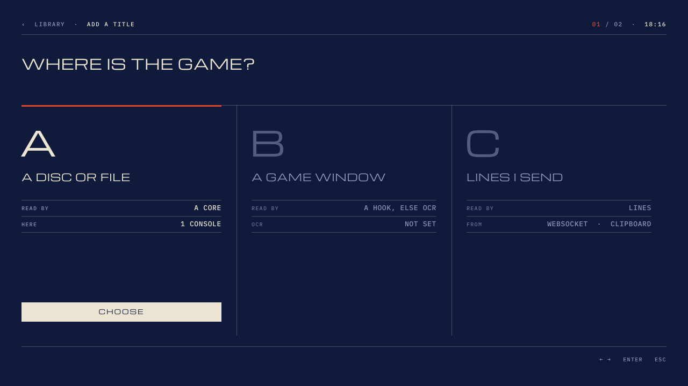
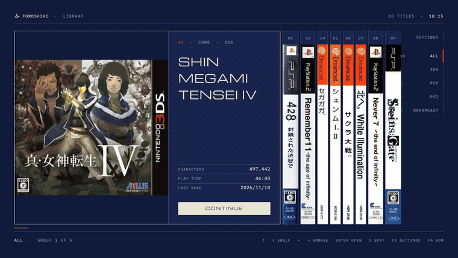
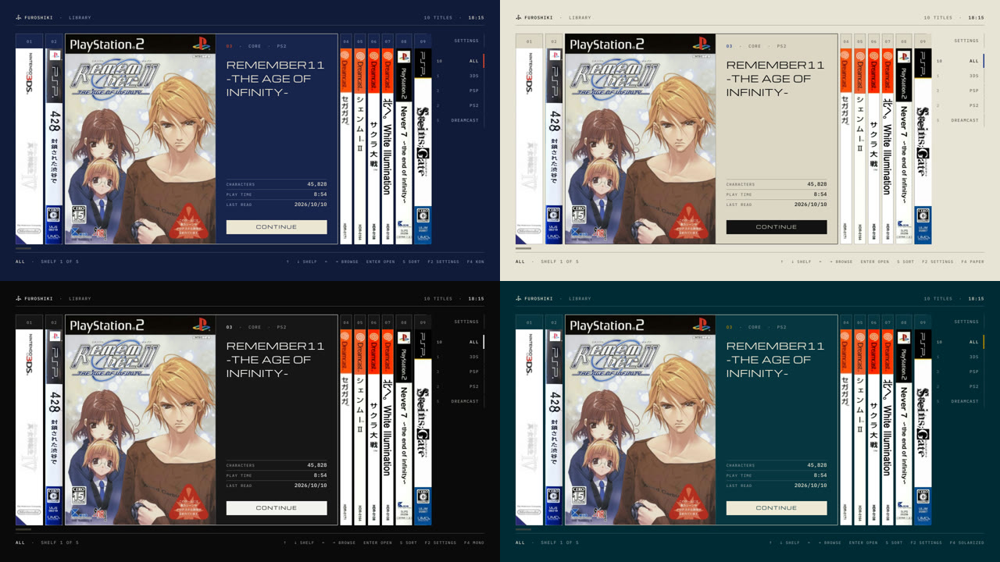
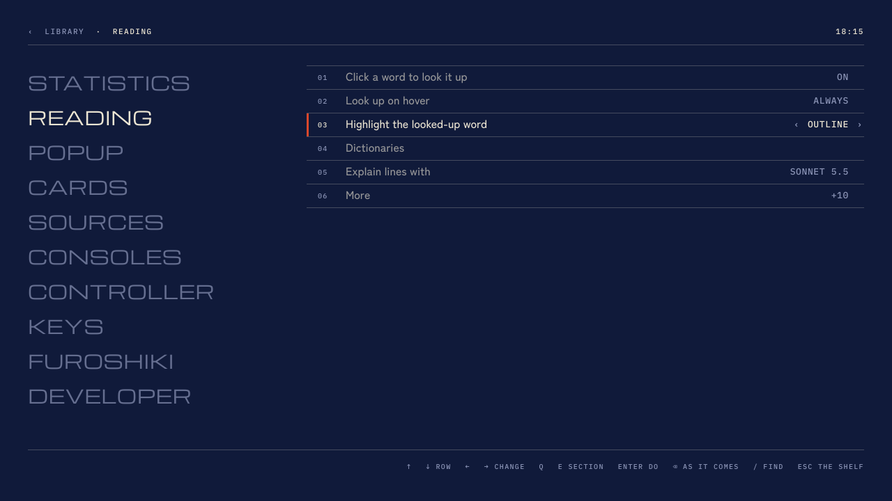

<h1 align="center">Furoshiki</h1>

<b>A game launcher with sentence mining built in, for Japanese games.</b> 
Hover a word in the game's own text and its entry opens beside it. One key makes the Anki card.

Furoshiki is a game launcher for Windows and Android: one library for your Japanese games, with
the emulators built in, and the tools for reading them (a dictionary popup, Anki cards, a
backlog) in the same program. There is no second window to keep beside the game and nothing to
copy and paste.

**It is designed around the games it supports.** Each [supported game](#supported-games) has a
script written for it that reads its text straight from the game's memory, along with where
every character sits on the screen. That is what makes the picture above possible: the words you
point at are the game's own, the lookup is instant, and nothing is guessed from a screenshot.

**Anything else can still be played and read**, by more general means: a text hook or OCR for PC
games, or lines sent from another tool. These work with far more games and are less exact. They
are described [further down](#games-without-a-script).

- **Lookups are instant.** A Yomitan-style popup opens next to the word, with deinflection, your
  own Yomitan dictionaries and each game's character names.
- **Cards in one press.** The sentence, a screenshot and the line's audio go to Anki, with the
  lines before it as context if you want them.
- **One launcher for all of it.** Six consoles are built in as cores, as in RetroArch: one
  library, one set of settings, the same reading tools everywhere.

| Console | Core | Windows | Android |
| --- | --- | --- | --- |
| PlayStation | DuckStation | ✓ | ✓ |
| PlayStation 2 | PCSX2 (ARMSX2 on Android) | ✓ | ✓ |
| PSP | PPSSPP | ✓ | ✓ |
| Dreamcast | Flycast | ✓ | ✓ |
| Nintendo 3DS | Azahar | ✓ | ✓ |
| PS Vita | Vita3K | ✓ | ✓ |

A console game without a script still plays in Furoshiki, just without the reading tools.

## Games without a script

For what the scripts do not cover, on Windows:

| The game is | Read by |
| --- | --- |
| A PC game | A **text hook** started by Furoshiki: an Agent script, LunaHook or Textractor |
| A PC game no hook reads | **OCR** of the game's window, four times a second |
| Anything else that produces text | Lines from a texthooker's WebSocket, or the clipboard |

These give the lines of text, shown in a strip you look words up in, and over the game's window
itself where its place is known. Cards, the backlog and the reading figures work the same.

*Add a title* asks which of these it is and sets it up:

Hooks are fetched the first time you use one (Agent's scripts, LunaHook and Textractor are their
authors' own projects and are not part of this repository).

OCR is done by **Furoshiki's OCR helper**, a small service on your own computer that Furoshiki
starts and stops by itself. It is a separate download (below), because it brings a Python and an
OCR model of about 1 GB with it. You choose the engine: meikiocr (the default), OneOCR or Chrome
Screen AI, which all read on your computer, or Google Lens, which sends each text area to Google.
A game can have several text boxes, read together as one line, and boxes that are read only when
you press Ctrl+Shift+R (a menu, a status screen).

## The shelf

Every title stands as a spine with its box art. The one in hand opens to its cover, what you have
read of it and the one key that plays it.

Type and hairlines, in four themes: Kon, Paper, Mono and Solarized. Android has the same look,
laid out for phones, folding phones and handhelds with two displays.

## Reading and mining

- **Cards**: the sentence, a screenshot and the audio, trimmed to the voice. A card of several
  lines from the backlog, a card of just the word (Ctrl+W), and the last card taken back (Ctrl+Z).
  Cards go to Anki through AnkiConnect on Windows and to AnkiDroid on Android.
- **Backlog** of everything read, with each line's speaker where the game names one.
- **Names**: each supported game comes with its characters' names and readings, looked up before
  the general dictionaries.
- **Explain** (Ctrl+E): a line's translation and grammar from Claude Code on your own computer,
  if you have it installed. Nothing is sent anywhere otherwise.
- **The popup** has a design page with a live preview, and an opacity slider so the game shows
  through it.
- **Reading figures** for each title: characters read, time, and characters an hour.
- **A controller is enough**: a button turns the sticks into the pointer, and on a Steam
  Controller the trackpad always points.

## The picture

- **A CRT effect** for every console but the Vita, with sliders and ready-made looks: scan lines,
  the phosphor's pattern, curved glass and a glow that spreads off what is bright. On Windows with
  an HDR screen the lit phosphor can shine brighter than white (Dreamcast, PSP and PS2).
- **Widescreen** (16:9, 21:9, 32:9) for the PS2 games that have a checked recipe: the 3D is drawn
  wide and the 2D keeps its shape. Nothing is ever stretched.
- Upscaling and each core's own picture settings, for all consoles, one console or one game.

## Settings

By what they are for: Reading, Popup, Cards, Sources, Consoles, Controller, Keys. Each page shows
the few rows most people change, with the rest behind *More*. `/` finds a setting by name, a
small square marks what you changed, and Backspace puts it back. Keyboard, controller or mouse
alone is enough for all of it.

## On Android

The same shelf, cores, scripts and lookups, by touch or with a controller. Tap a word in the
game's text to look it up. On-screen buttons and a stick where the device has none, and a menu
over the game with savestate slots, disc change, fast forward, skip to the next choice, patches
and cheat codes. A game can be pinned to the home screen. On a handheld with two displays the
second one is a trackpad, or a 3DS game's lower screen.

## Supported games

A game is read through its **game script**, a small Lua file for that game's version. You install
scripts inside Furoshiki from each console's list (*Game scripts*), and it checks every file
against the list before installing it. A game with no script still plays, just without the
reading tools. Scripts are for the Japanese release of each game.

<b>PlayStation</b> (4 games)

| Game | Title | What is read |
| --- | --- | --- |
| Kamaitachi no Yoru | かまいたちの夜 特別篇 | Story text and choices |
| Double Cast | ダブルキャスト | Film subtitles and choices |
| Aconcagua | アコンカグア | Message windows |
| Gakkou de Atta Kowai Hanashi S | 学校であった怖い話S | Story text and choices |

<b>PlayStation 2</b> (11 games)

| Game | Title | What is read |
| --- | --- | --- |
| Ever17 | Ever17 -the out of infinity- Premium Edition | Story text with speakers, choices |
| Never7 | Never7 -the end of infinity- | Story text with speakers, choices |
| Remember11 | Remember11 -the age of infinity- | Story text with speakers, choices |
| CLANNAD | CLANNAD | Story text with speakers, choices |
| Higurashi no Naku Koro ni Matsuri | ひぐらしのなく頃に祭 カケラ遊び | Story text with speakers and furigana |
| Amagami | アマガミ | Message window with furigana |
| EVE burst error PLUS | EVE burst error PLUS | Message window |
| Utawarerumono | うたわれるもの 散りゆく者への子守唄 | Message window with speakers |
| Shadow Hearts | シャドウハーツ | Scene and talk windows with speakers |
| Dragon Quest V | ドラゴンクエストV 天空の花嫁 | Message window |
| Silent Hill 2 | サイレントヒル2 | Subtitles |

<b>PSP</b> (10 games)

| Game | Title | What is read |
| --- | --- | --- |
| Steins;Gate | STEINS;GATE | Message window with speakers and furigana, phone mails |
| Chaos;Head Love Chu Chu! | CHAOS;HEAD らぶChu☆Chu! | Message window with furigana |
| 428: Shibuya Scramble | 428 ～封鎖された渋谷で～ | Story text with furigana, TIPS, choices |
| Danganronpa | ダンガンロンパ 希望の学園と絶望の高校生 | Message box with speakers |
| Trails in the Sky FC | 英雄伝説 空の軌跡FC | Talk windows with speakers |
| Tokimeki Memorial Forever with You | ときめきメモリアル forever with you | Message window with speakers, choices |
| Grisaia no Kajitsu | グリザイアの果実 -LE FRUIT DE LA GRISAIA- | Message window with speakers, choices |
| Da Capo I&II Plus Situation Portable | D.C.I&II P.S.P. | Message window with speakers and furigana |
| My Merry May with be | My Merry May with be | Story text with speakers |
| Dunamis 15 | DUNAMIS15 | Message window with speakers and furigana |

<b>Dreamcast</b> (8 games)

| Game | Title | What is read |
| --- | --- | --- |
| Shenmue II (Windows only for now) | シェンムーII | Subtitles |
| What's Shenmue | What's シェンムー 〜湯川(元)専務をさがせ〜 | Subtitles |
| Sakura Taisen | サクラ大戦 | Message window, timed choices |
| Segagaga | セガガガ | Message window |
| Rent a Hero No.1 | レンタヒーロー No.1 | Message window |
| Kita e. White Illumination | 北へ。White Illumination | Message window |
| July | July | Message window with speakers, choices |
| Ayanami Raising Project | 新世紀エヴァンゲリオン 綾波育成計画 | Message window |

<b>Nintendo 3DS</b> (1 game)

| Game | Title | What is read |
| --- | --- | --- |
| Shin Megami Tensei IV | 真・女神転生IV | Dialogue, narration and choices |

<b>PS Vita</b> (1 game)

| Game | Title | What is read |
| --- | --- | --- |
| Trails in the Sky FC Evolution | 英雄伝説 空の軌跡 FC Evolution | Talk windows with speakers |

A few more games are supported but can't be listed here: their scripts need a table made from
the game's own files, which can't be published.

## Setting up

Nothing from a console maker is included. You bring your own games, dumped from discs or
cartridges you own, plus:

| Console | You need | Windows | Android |
| --- | --- | --- | --- |
| PlayStation | The BIOS (e.g. `SCPH-5500.bin`) | `program\consoles\ps1\system` | `Games/BIOS/PS1` |
| PlayStation 2 | The BIOS | `program\consoles\ps2\system` | `Games/BIOS/PS2` |
| PSP | Nothing | | |
| Dreamcast | Nothing (a BIOS of your own is optional) | `program\consoles\dc\system\dc\dc_boot.bin` | |
| Nintendo 3DS | Decrypted games; keys only where a game asks for them | `program\consoles\3ds\system` | |
| PS Vita | The firmware (`PSVUPDAT.PUP`, plus `PSP2UPDAT.PUP` if you have it) | `program\consoles\psvita\system` | `Games/BIOS/Vita` |

**Windows:** the folders above are in `%LOCALAPPDATA%\Furoshiki`. Add your game folders in the
program.

**Android:** put games in a `Games` folder on the device or SD card, one subfolder per console
(`Games/PS2`, `Games/PSP`...), or add your own folders in Settings.

**Dictionaries:** Yomitan-format zips. On Windows you import them in the program. On Android, put
them in `Games/Dictionaries` and they're imported at first start.

**Anki:** cards go to Anki through AnkiConnect on Windows, and to AnkiDroid on Android.

## Download

From the [latest release](../../releases/latest):

> Furoshiki 3 (the shelf, hooks, OCR and its helper) is in the source now and comes as release
> 0.2.0. Until that is out, the latest release is 0.1.2, which has the consoles and their scripts
> in the earlier look.

- **Windows** (`Furoshiki-<version>-windows.zip`): unzip it anywhere and run `Furoshiki.exe`. The
  PS2 and Vita cores need the
  [Microsoft Visual C++ Redistributable (x64)](https://aka.ms/vs/17/release/vc_redist.x64.exe), as
  PCSX2 does.
- **Android** (`Furoshiki-<version>-android.apk`): Android 10 or later, 64-bit ARM. Install it by
  hand, and allow it to see all files when it asks, so it can read your games where they are.

- **OCR helper, optional** (`Furoshiki-ocr-helper.zip`, Windows): only for PC games read by OCR.
  Unzip it into Furoshiki's folder and run `install.cmd`; it fetches what it needs (about 1 GB)
  into a folder of its own there, without an administrator. `home/ocr-helper/README.md` has
  more.

Then install a console's game scripts from *Game scripts*, and the games they read appear in your
library.

## Building from source

| Folder | What it is |
| --- | --- |
| `home/` | Furoshiki for Windows and Linux |
| `android/` | Furoshiki for Android |
| `shared/` | The lookup and mining layer, used everywhere |
| `home/ocr-helper/` | The OCR helper (Python): `package.sh` makes its zip |
| `cores/` | The interface between Furoshiki and the cores |
| `station/`, `pcsx2/`, `armsx2/`, `ppsspp/`, `flycast/`, `azahar/`, `vita3k/` | Each emulator, with its core and its game scripts |

Fetch an emulator's third-party code with `git submodule update --init --recursive -- <folder>`.
Then:

- **A core:** `<emulator>/tools/reader/build-core-windows.sh`, `build-core-android.sh` or
  `build-core.sh` (Linux)
- **Windows:** `HOME_PUBLIC=1 home/tools/build-windows.sh`, then
  `HOME_PUBLIC=1 home/tools/package-windows.sh`
- **Android:** `android/tools/build.sh`

The scripts build on Linux and find their compilers through each folder's `tools/reader/env.sh`,
which names the toolchains they expect.

## Licence

Furoshiki and the cores are free software under the **GNU General Public License, version 3**
(`COPYING`; the folders `home/`, `cores/` and `shared/` each carry it too). Each emulator keeps
its own licence and its authors' notices in its folder. `NOTICES.md` lists what is in the
packages and under which terms, including why Flycast's code, whose `LICENSE` file is the
GPLv2 text, is distributed here under version 3.

This project is not affiliated with Sony, Sega, Nintendo, or the emulators' projects. Please
do not report its problems to them.
