# Furoshiki

Furoshiki (風呂敷, the cloth that wraps and carries anything) plays Japanese games of seven
consoles and reads their text as text: point at a word on the screen and it is looked up in your
dictionaries, sent to Anki as a card, kept in a backlog, and counted in reading statistics kept on
your own device. Each console is an emulator built as a *core*; the reading layer over the picture
is the same for all of them. **Windows** (a desktop program) and **Android** (one app, made for a
finger first, a controller too).

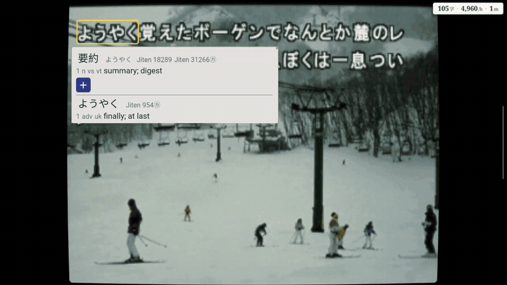

| Console | Core made from | Windows | Android |
| --- | --- | --- | --- |
| PlayStation | DuckStation (a 2021 version, `station/`) | ✓ | ✓ |
| PlayStation 2 | PCSX2 (`pcsx2/`), ARMSX2 on Android (`armsx2/`) | ✓ | ✓ |
| PSP | PPSSPP (`ppsspp/`) | ✓ | ✓ |
| Dreamcast | Flycast (`flycast/`) | ✓ | ✓ |
| Nintendo 3DS | Azahar (`azahar/`) | ✓ | ✓ |
| PS Vita | Vita3K (`vita3k/`) | | ✓ |

## What it looks like

All pictures are of Furoshiki for Android on an AYN Thor, the games' own text read as it comes up.

**Metal Gear Solid 2: Substance** (PS2). Its kanji have no codes at all; the script knows each
by its picture, from a table made from the game's own files (so it is not in the published list:
see "What it reads"). The radio call's lines, looked up as they go by:

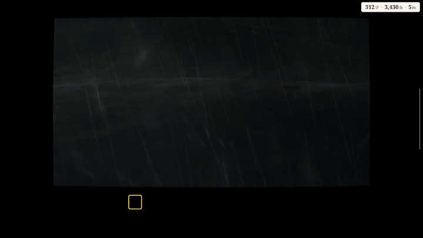

**Shin Megami Tensei IV** (3DS), on a device with two displays: the lower screen goes to the second one.

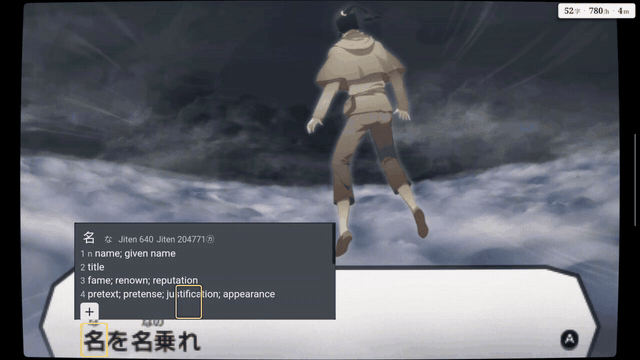 
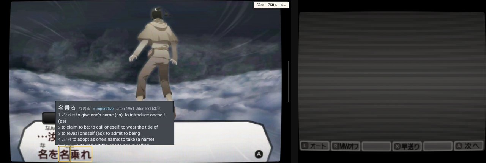

**The Legend of Heroes: Trails in the Sky FC Evolution** (Vita), the speaker's name with each line:

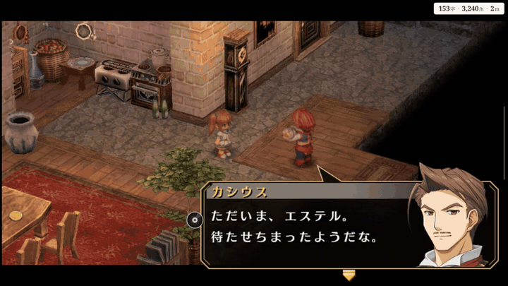

<table>
<tr><td>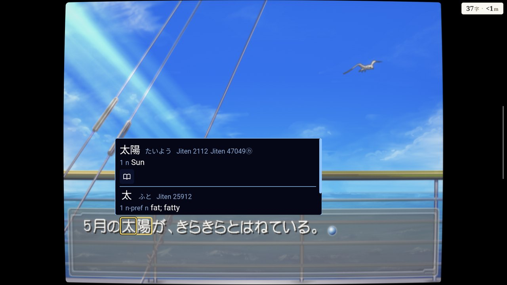 <b>Ever17</b> (PS2)</td>
<td>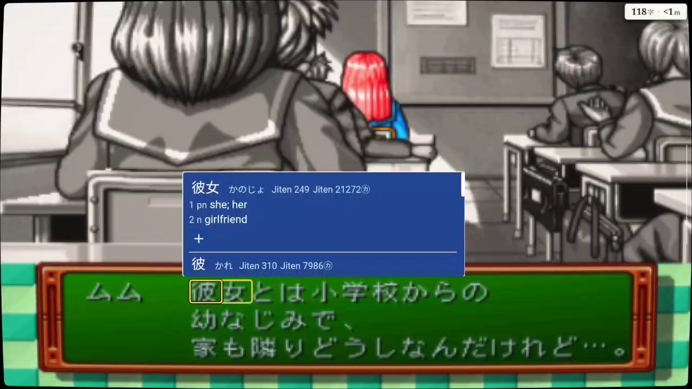 <b>Tokimeki Memorial Forever with You</b> (PSP)</td></tr>
<tr><td>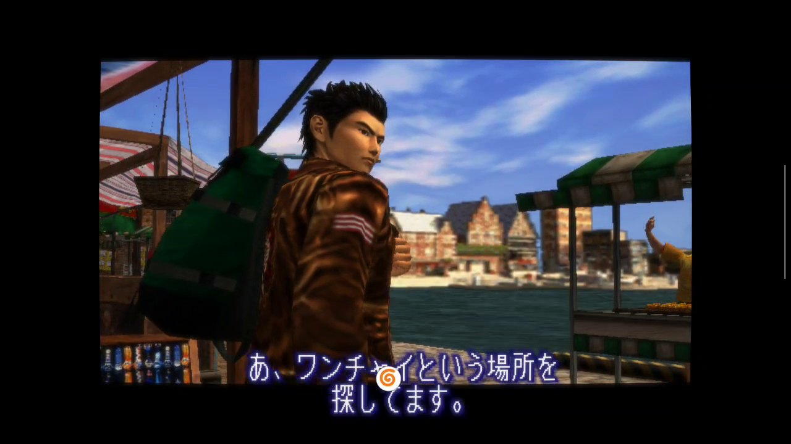 <b>Shenmue II</b> (Dreamcast): its subtitles</td>
<td>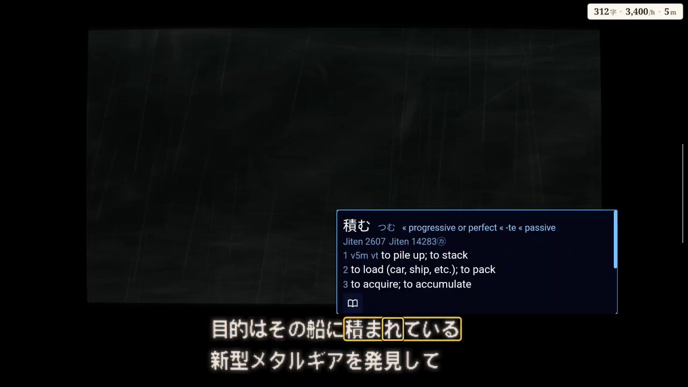 <b>Metal Gear Solid 2: Substance</b> (PS2)</td></tr>
</table>

**The menus.** The library, one page a console, each game with its box art and what you have
read of it; the consoles' settings, in layers (all consoles, one console, one game); the menu of a
game in play, the reader's own menu, and the backlog of what was read.

<table>
<tr><td>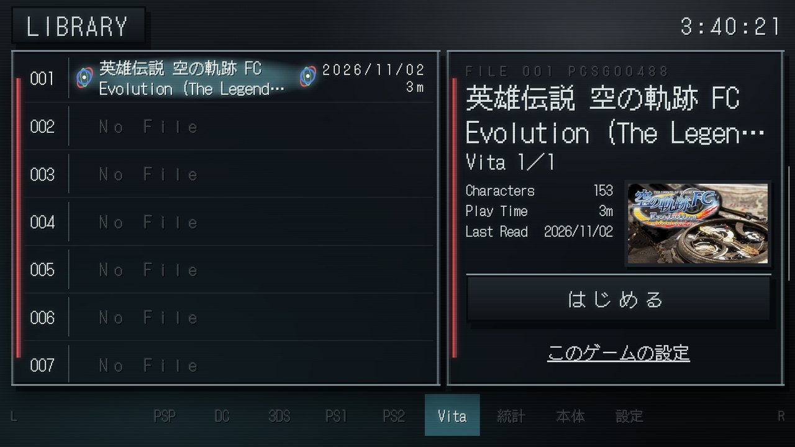</td>
<td>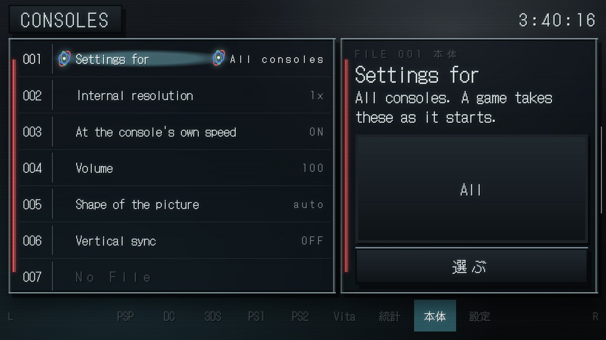</td></tr>
<tr><td>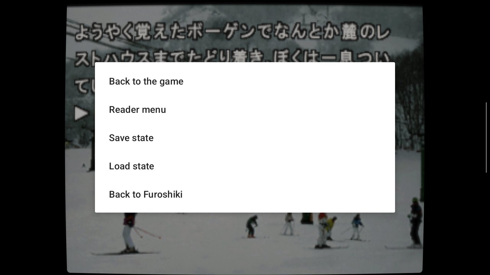</td>
<td></td></tr>
<tr><td>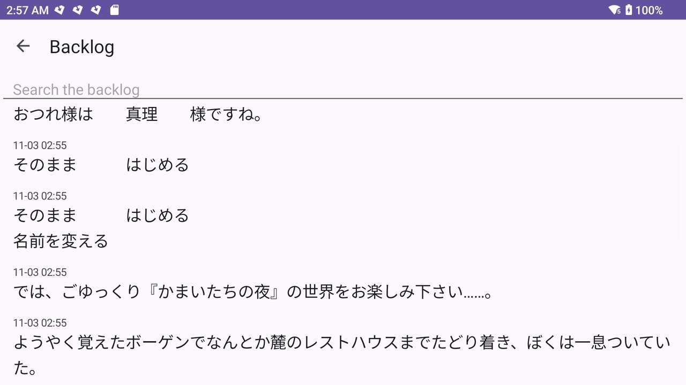</td>
<td>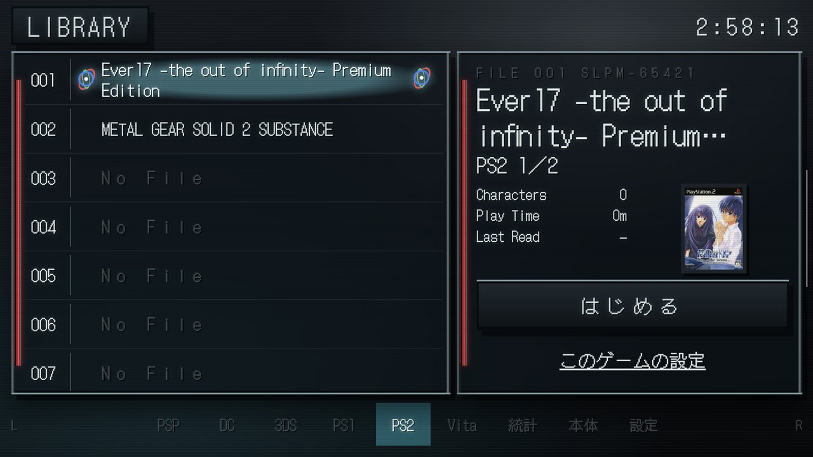</td></tr>
</table>

## What it reads

A game is read through a **game script**: a short Lua file, named after the game's ID (the
disc's serial, or the 3DS title ID), that says where the game keeps the text it shows. The
program has none built in. It shows each console's published list (the reader's *Game
scripts* window: what is there, for which version of the game, what it reads) and installs
the ones you choose; each file is checked against the size and SHA-256 the list gives before
it is installed. Games without a script still play, without the reading layer. The lists are
`index.json` beside each console's scripts in this repository (`ppsspp/assets/reader/profiles`,
`flycast/reader/profiles`, `pcsx2/reader/profiles`, `station/reader/profiles`, the 3DS's in
`azahar/`, the Vita's in `vita3k/reader/profiles`; the Android app's PS2 list is ARMSX2's, in
`armsx2/`).

Some scripts need a table made from the game's own font to turn its glyphs into characters;
those tables are made from the game and are not published, so those games are not in the
lists.

## What you bring

Nothing of a console maker's is in this repository or in the program. You bring:

- **Your games**, dumped from discs or cartridges you own.
- **The PlayStation's BIOS** (e.g. `SCPH-5500.bin`) in `program/consoles/ps1/system`.
- **The PlayStation 2's BIOS** in `program/consoles/ps2/system`.
- **The Dreamcast's BIOS**, if you want it (`program/consoles/dc/system/dc/dc_boot.bin`, where
  Flycast's libretro core looks): without one Flycast's own stand-in starts the game.
- **The PSP** needs nothing: PPSSPP's own system files come with its core.
- **The 3DS**: decrypted games play as they are; Azahar's system files and keys, where a game
  wants them, go in `program/consoles/3ds/system`.

These folders are in Furoshiki's own folder: `%LOCALAPPDATA%\reader-home` on Windows,
`~/.local/share/reader-home` on Linux (the folder keeps the program's former name).
Dictionaries are Yomitan-format zip files you import yourself.

## Android

Furoshiki for Android (Android 10 or later, arm64) looks for games in a folder called `Games`
(or `Reader Games`) on the device and on its cards, one folder a console (`Games/PSP`,
`Games/PS2`...), and in the folders you add on its Settings page. What a console needs of yours
goes in `Games/BIOS/<console>`: the PlayStation's BIOS in `Games/BIOS/PS1`, the PS2's in
`Games/BIOS/PS2`, the Vita's firmware (`PSVUPDAT.PUP`, and `PSP2UPDAT.PUP` if you have it) in
`Games/BIOS/Vita`. Yomitan dictionaries in `Games/Dictionaries` are imported at the first
start. A console's game scripts are installed from its list on the Settings page (*Game
scripts*), and the games they read are listed. Cards go to AnkiDroid. The app plays each game in
a process of its own; its settings are in layers (all consoles, one console, one game), as on
the desktop.

## Download and build

- **Windows**: the zip of a [release](../../releases) (unzip it anywhere, run `reader-home.exe`).
  PCSX2's core needs the Microsoft Visual C++ Redistributable (x64), as PCSX2 does.
- **Android**: the APK of a release. It is installed by hand (allow it to see all files when it
  asks, as it reads the games where they are).
- **Building**: the program is built with `-DHOME_CORES=ON -DHOME_PUBLIC=ON`
  (`READER_HOME_PUBLIC=1 home/tools/build-desktop.sh`, or `build-windows.sh`), each core from
  its emulator's folder (`<emulator>/tools/reader/build-core*.sh`). The Android app: each
  core with `<emulator>/tools/reader/build-core-android.sh`, then `android/tools/build.sh`. Third-party code the emulators take as Git
  submodules is in `.gitmodules`: `git submodule update --init --recursive -- <folder>`.

## Licence

Furoshiki and the cores are free software under the **GNU General Public License, version 3**
(`COPYING`; the folders `home/`, `cores/` and `shared/` each carry it too). Each emulator keeps
its own licence and its authors' notices in its folder. `NOTICES.md` lists what is in the
Windows package and under which terms, including why Flycast's code, whose `LICENSE` file is the
GPLv2 text, is distributed here under version 3.

This project is not affiliated with Sony, Sega, Nintendo, or the emulators' projects. Please
do not report its problems to them.
