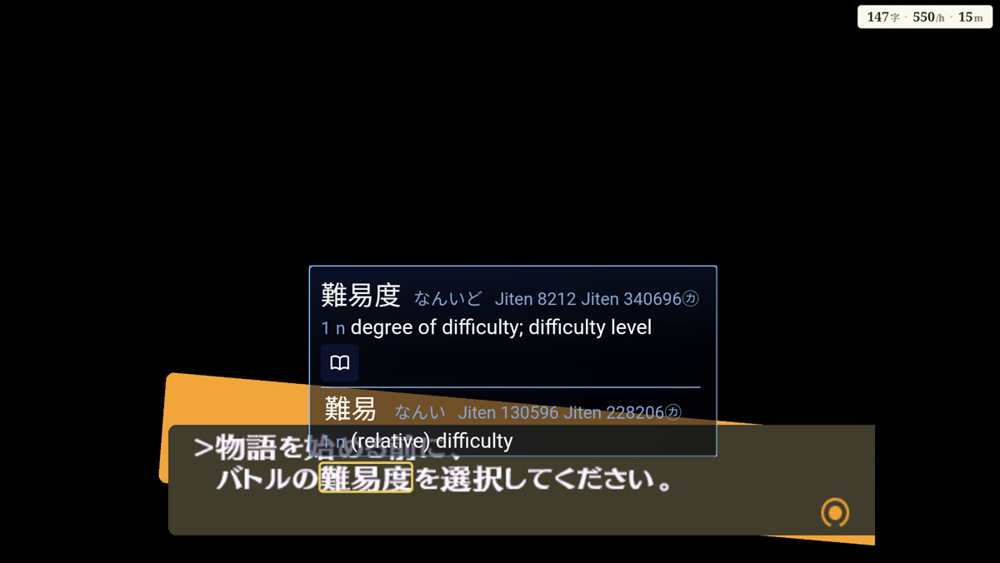
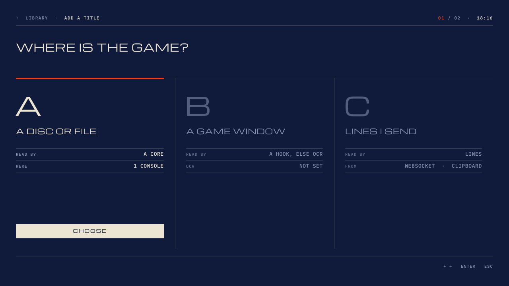
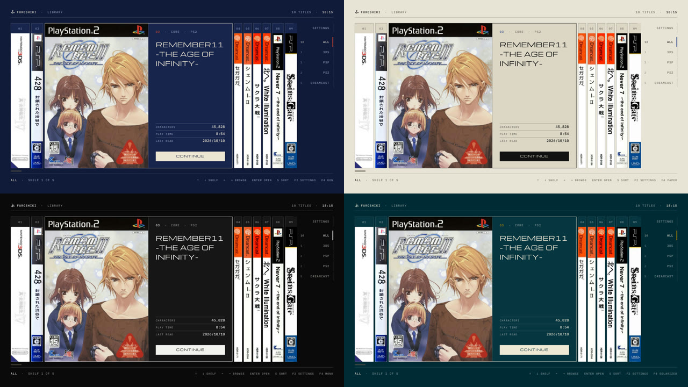

<h1 align="center">Furoshiki</h1>

<b>A game launcher with sentence mining built in, for Japanese games.</b> 
OCR and texthooking with overlay on Android and Windows.

<b>Latest releases:</b>
<a href="../../releases/download/v0.2.6/Furoshiki-0.2.6-android.apk">Android 0.2.6</a> ·
<a href="../../releases/download/v0.2.3/Furoshiki-0.2.3-windows.zip">Windows 0.2.3</a> ·
<a href="../../releases/download/v0.2.3/Furoshiki-ocr-helper.zip">OCR helper (Windows)</a> ·
<a href="../../releases">all releases</a>

Furoshiki is a game launcher for Windows and Android: one library for your Japanese games, with
the emulators built in, and the tools for reading them (a dictionary popup, Anki cards, a
backlog) in the same program.

**It is designed around a handful of specific games.** Each [supported game](#supported-games) has a
script written for it that reads its text straight from the game's memory, along with where
every character sits on the screen. 

**Anything else can still be played and read** - a text hook or OCR for PC
games, or lines sent from another tool. They
are described [further down](#games-without-a-script).

- **Lookups are instant.** A dictionary popup opens next to the word, your
  own Yomitan dictionaries and each game's character names.
- **Cards in one press.** The sentence, a screenshot and the line's audio go to Anki.
- **One launcher for all of it.** Seven consoles are built in as cores, and their settings are divided and shared as desired.

| Console | Core | Windows | Android |
| --- | --- | --- | --- |
| PlayStation | DuckStation | ✓ | ✓ |
| PlayStation 2 | PCSX2 (ARMSX2 on Android) | ✓ | ✓ |
| PSP | PPSSPP | ✓ | ✓ |
| Dreamcast | Flycast | ✓ | ✓ |
| Nintendo 3DS | Azahar | ✓ | ✓ |
| PS Vita | Vita3K | ✓ | ✓ |
| Nintendo DS | melonDS | (to come) | ✓ |

A console game without a script still plays in Furoshiki, and can be read by OCR (below).

## Games without a script

Furoshiki supports OCR on Android and Windows, and text hooks on Windows.

For PC games and other sources, on Windows:

| The game is | Read by |
| --- | --- |
| A PC game | A **text hook** started by Furoshiki: an Agent script, LunaHook or Textractor |
| A PC game no hook reads | **OCR** of the game's window, four times a second |
| Anything else that produces text | Lines from a texthooker's WebSocket, or the clipboard |

These give the lines of text, shown in a strip you look words up in, and over the game's window
itself where its place is known. Cards, the backlog and the reading figures work the same.

*Add a title* asks which of these it is and sets it up:

Hooks are fetched the first time you use one (Agent's scripts, LunaHook and Textractor are their
authors' own projects and are not part of this repository).

On Windows, OCR is done by **Furoshiki's OCR helper**, a small service on your own computer that Furoshiki
starts and stops by itself. It is a separate download (below), because it brings a Python and an
OCR model of about 1 GB with it. You choose the engine: meikiocr (the default), OneOCR or Chrome
Screen AI, which all read on your computer, or Google Lens, which sends each text area to Google.
A game can have several text boxes, read together as one line, and boxes that are read only when
you press Ctrl+Shift+R (a menu, a status screen).

On Android, OCR runs on the device with meikiocr (the default, nothing sent anywhere), or with
Google Lens, the best reading of the three, which sends each text area to Google. The engine is
chosen in Settings, *OCR engine*.

## Layout

## Reading and mining

- **Cards**: the sentence, a screenshot and the audio, trimmed to the voice. A card of several
  lines from the backlog, a card of just the word (Ctrl+W), and the last card taken back (Ctrl+Z).
  Cards go to Anki through AnkiConnect on Windows and to AnkiDroid on Android.
- **Backlog** of everything read including character names.
- **Names**: each supported game comes with its characters' names and readings.
- **The popup** has a design page with a live preview, and an opacity slider so the game shows
  through it. The Windows popup is highly customisable.
- **Stats** for each title: characters read, time, and characters an hour.
- **Controller support**: Furoshiki was developed with a Steam Controller, which is the easiest way to use the pointer. You can also map a hotkey to activating a pointer on screen you can control with the sticks instead.

## The picture

- **A CRT effect** for some consoles, with sliders and ready-made looks. Scan lines,
  the phosphor's pattern, curved glass, etc. On Windows with
  an HDR screen the lit phosphor can shine brighter than white (Dreamcast, PSP and PS2).
- Upscaling and each core's own picture settings, for all consoles, one console or one game.

## On Android

Tap a word in the game's text to look it up. On-screen buttons and a stick where the device has none, and a menu
over the game with savestate slots, fast forward, skip to the next choice and patches. A game can be pinned to the home screen. On a handheld with two displays the
second one is a trackpad, or a 3/DS game's lower screen.

At first start, setup asks where your games are (one folder, or one after another if each
console has its own) and for your GameNative folder. Every game found is listed, and the
scripts for the supported ones are fetched by themselves.

On a handheld with two displays, such as the **AYN Thor**, the shelf is above, with a page for
each console, and below it the title in hand with the button to play it.

In a game the lower display is for looking words up, in one of two ways:

- **Trackpad.** Move the pointer over the game's own text from the lower display. The word under
  the pointer is looked up, and the popup opens over the game.

  

- **Line.** Press **Line** to show the line under the trackpad as well. Tap a word in it, and the
  popup opens on the lower display, leaving the game clear.

  

The keys along the bottom pause the game or the reading stats, and open the backlog and the
menu. Cards are made from the popup.

### GameNative and other apps

PC games played in **GameNative**, and games in any other app, can be read too. Furoshiki starts
the game, asks once to capture the screen, and reads the game's text by OCR: meikiocr on the
device, or Google Lens (Settings, *OCR engine*). Words are looked up over the game itself, or in
the line on a second display. **Area** marks where the game's text is, when the whole screen has
too much else in it.

To list your GameNative games by themselves and start them directly:

1. In GameNative, open Settings › Interface › **Frontend Sync**, turn it on and choose a folder
   (a new one, such as `Games/GameNative`).
2. In Furoshiki, choose that same folder: setup asks for it, and Settings has
   *Add GameNative folder*.

The games then stand on a GameNative shelf of their own. A game of any other app is added by
hand with **Add a game**: choose the app and give the game its name.

## Supported games

A game is read through its **game script**, a small Lua file for that game's version. You install
scripts inside Furoshiki from each console's list (*Game scripts*), and it checks every file
against the list before installing it. A game with no script still plays, just without the
reading tools. Scripts are for the Japanese release of each game.

<b>PlayStation</b> (4 games)

| Game | Title | What is read |
| --- | --- | --- |
| Kamaitachi no Yoru | かまいたちの夜 特別篇 | Story text and choices |
| Double Cast | ダブルキャスト | Film subtitles and choices |
| Aconcagua | アコンカグア | Message windows |
| Gakkou de Atta Kowai Hanashi S | 学校であった怖い話S | Story text and choices |

<b>PlayStation 2</b> (11 games)

| Game | Title | What is read |
| --- | --- | --- |
| Ever17 | Ever17 -the out of infinity- Premium Edition | Story text with speakers, choices |
| Never7 | Never7 -the end of infinity- | Story text with speakers, choices |
| Remember11 | Remember11 -the age of infinity- | Story text with speakers, choices |
| CLANNAD | CLANNAD | Story text with speakers, choices |
| Higurashi no Naku Koro ni Matsuri | ひぐらしのなく頃に祭 カケラ遊び | Story text with speakers and furigana |
| Amagami | アマガミ | Message window with furigana |
| EVE burst error PLUS | EVE burst error PLUS | Message window |
| Utawarerumono | うたわれるもの 散りゆく者への子守唄 | Message window with speakers |
| Shadow Hearts | シャドウハーツ | Scene and talk windows with speakers |
| Dragon Quest V | ドラゴンクエストV 天空の花嫁 | Message window |
| Silent Hill 2 | サイレントヒル2 | Subtitles |

<b>PSP</b> (10 games)

| Game | Title | What is read |
| --- | --- | --- |
| Steins;Gate | STEINS;GATE | Message window with speakers and furigana, phone mails |
| Chaos;Head Love Chu Chu! | CHAOS;HEAD らぶChu☆Chu! | Message window with furigana |
| 428: Shibuya Scramble | 428 ～封鎖された渋谷で～ | Story text with furigana, TIPS, choices |
| Danganronpa | ダンガンロンパ 希望の学園と絶望の高校生 | Message box with speakers |
| Trails in the Sky FC | 英雄伝説 空の軌跡FC | Talk windows with speakers |
| Tokimeki Memorial Forever with You | ときめきメモリアル forever with you | Message window with speakers, choices |
| Grisaia no Kajitsu | グリザイアの果実 -LE FRUIT DE LA GRISAIA- | Message window with speakers, choices |
| Da Capo I&II Plus Situation Portable | D.C.I&II P.S.P. | Message window with speakers and furigana |
| My Merry May with be | My Merry May with be | Story text with speakers |
| Dunamis 15 | DUNAMIS15 | Message window with speakers and furigana |

<b>Dreamcast</b> (8 games)

| Game | Title | What is read |
| --- | --- | --- |
| Shenmue II (Windows only for now) | シェンムーII | Subtitles |
| What's Shenmue | What's シェンムー 〜湯川(元)専務をさがせ〜 | Subtitles |
| Sakura Taisen | サクラ大戦 | Message window, timed choices |
| Segagaga | セガガガ | Message window |
| Rent a Hero No.1 | レンタヒーロー No.1 | Message window |
| Kita e. White Illumination | 北へ。White Illumination | Message window |
| July | July | Message window with speakers, choices |
| Ayanami Raising Project | 新世紀エヴァンゲリオン 綾波育成計画 | Message window |

<b>Nintendo 3DS</b> (1 game)

| Game | Title | What is read |
| --- | --- | --- |
| Shin Megami Tensei IV | 真・女神転生IV | Dialogue, narration and choices |

<b>Nintendo DS</b> (2 games, Android)

| Game | Title | What is read |
| --- | --- | --- |
| Wish Room | ウィッシュルーム 天使の記憶 | Message windows with speakers, the choices; the game held like a book |
| 999: Nine Hours, Nine Persons, Nine Doors | 極限脱出 9時間9人9の扉 | Novel text and talk windows with speakers, escape rooms, choices, file pages |

<b>PS Vita</b> (1 game)

| Game | Title | What is read |
| --- | --- | --- |
| Trails in the Sky FC Evolution | 英雄伝説 空の軌跡 FC Evolution | Talk windows with speakers |

A few more games are supported but can't be listed here: their scripts need a table made from
the game's own files, which can't be published.

## Setting up

Nothing from a console maker is included. You bring your own games, dumped from discs or
cartridges you own, plus:

| Console | You need | Windows | Android |
| --- | --- | --- | --- |
| PlayStation | The BIOS (e.g. `SCPH-5500.bin`) | `program\consoles\ps1\system` | `Games/BIOS/PS1` |
| PlayStation 2 | The BIOS | `program\consoles\ps2\system` | `Games/BIOS/PS2` |
| PSP | Nothing | | |
| Dreamcast | Nothing (a BIOS of your own is optional) | `program\consoles\dc\system\dc\dc_boot.bin` | |
| Nintendo 3DS | Decrypted games; keys only where a game asks for them | `program\consoles\3ds\system` | |
| PS Vita | The firmware (`PSVUPDAT.PUP`, plus `PSP2UPDAT.PUP` if you have it) | `program\consoles\psvita\system` | `Games/BIOS/Vita` |
| Nintendo DS | Nothing (melonDS's own free BIOS is built in) | | |

**Windows:** the folders above are in `%LOCALAPPDATA%\Furoshiki`. Add your game folders in the
program.

**Android:** put games in a `Games` folder on the device or SD card, one subfolder per console
(`Games/PS2`, `Games/PSP`...), or add your own folders in Settings.

**Dictionaries:** Yomitan-format zips. On Windows you import them in the program. On Android, put
them in `Games/Dictionaries` and they're imported at first start.

**Anki:** cards go to Anki through AnkiConnect on Windows, and to AnkiDroid on Android.

## Download

From the [latest release](../../releases/latest):

- **Windows** (`Furoshiki-<version>-windows.zip`): unzip it anywhere and run `Furoshiki.exe`. The
  PS2 and Vita cores need the
  [Microsoft Visual C++ Redistributable (x64)](https://aka.ms/vs/17/release/vc_redist.x64.exe), as
  PCSX2 does.
- **Android** (`Furoshiki-<version>-android.apk`): Android 10 or later, 64-bit ARM. Install it by
  hand, and allow it to see all files when it asks, so it can read your games where they are.

- **OCR helper, optional** (`Furoshiki-ocr-helper.zip`, Windows): only for PC games read by OCR.
  Unzip it into Furoshiki's folder and run `install.cmd`; it fetches what it needs (about 1 GB)
  into a folder of its own there, without an administrator. `home/ocr-helper/README.md` has
  more.

Then install a console's game scripts from *Game scripts*, and the games they read appear in your
library.

## Building from source

| Folder | What it is |
| --- | --- |
| `home/` | Furoshiki for Windows and Linux |
| `android/` | Furoshiki for Android |
| `shared/` | The lookup and mining layer, used everywhere |
| `home/ocr-helper/` | The OCR helper (Python): `package.sh` makes its zip |
| `cores/` | The interface between Furoshiki and the cores |
| `station/`, `pcsx2/`, `armsx2/`, `ppsspp/`, `flycast/`, `azahar/`, `vita3k/`, `melonds/` | Each emulator, with its core and its game scripts |

Fetch an emulator's third-party code with `git submodule update --init --recursive -- <folder>`.
Then:

- **A core:** `<emulator>/tools/reader/build-core-windows.sh`, `build-core-android.sh` or
  `build-core.sh` (Linux)
- **Windows:** `HOME_PUBLIC=1 home/tools/build-windows.sh`, then
  `HOME_PUBLIC=1 home/tools/package-windows.sh`
- **Android:** `android/tools/build.sh`

The scripts build on Linux and find their compilers through each folder's `tools/reader/env.sh`,
which names the toolchains they expect.

## Licence

Furoshiki and the cores are free software under the **GNU General Public License, version 3**
(`COPYING`; the folders `home/`, `cores/` and `shared/` each carry it too). Each emulator keeps
its own licence and its authors' notices in its folder. `NOTICES.md` lists what is in the
packages and under which terms, including why Flycast's code, whose `LICENSE` file is the
GPLv2 text, is distributed here under version 3.

This project is not affiliated with Sony, Sega, Nintendo, or the emulators' projects. Please
do not report its problems to them.
