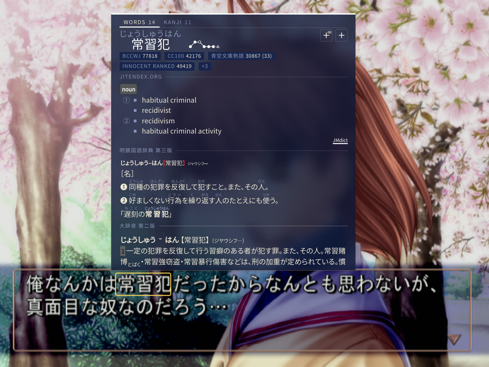
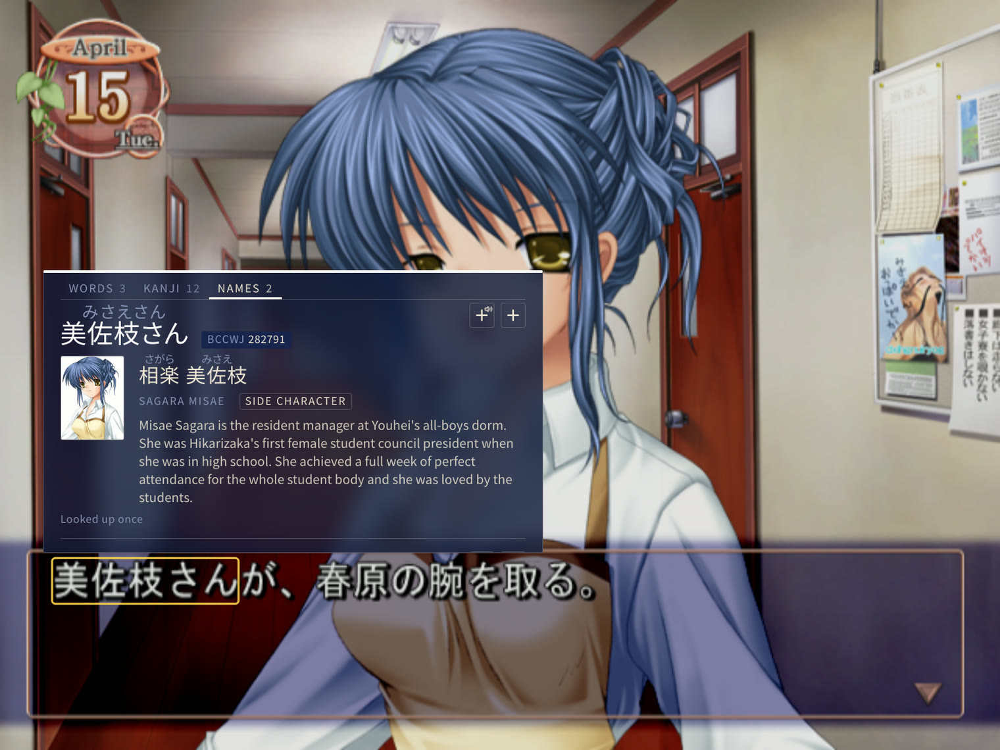
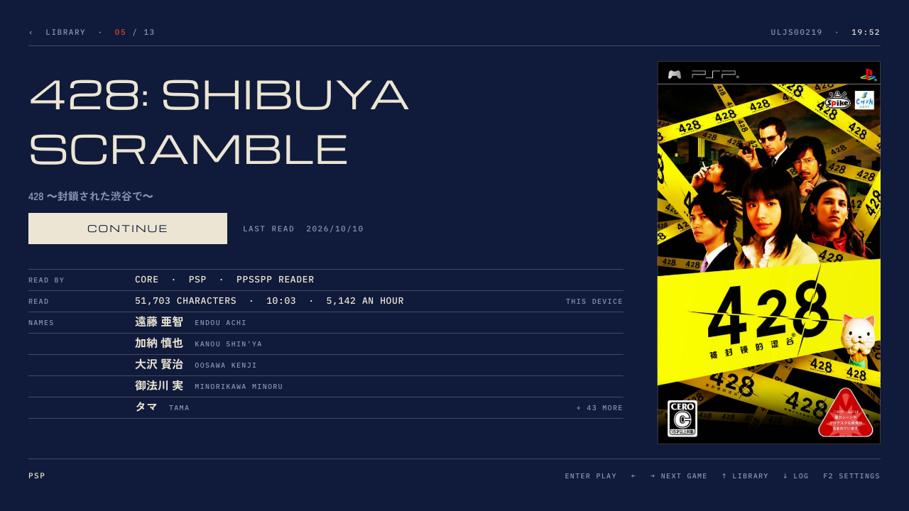
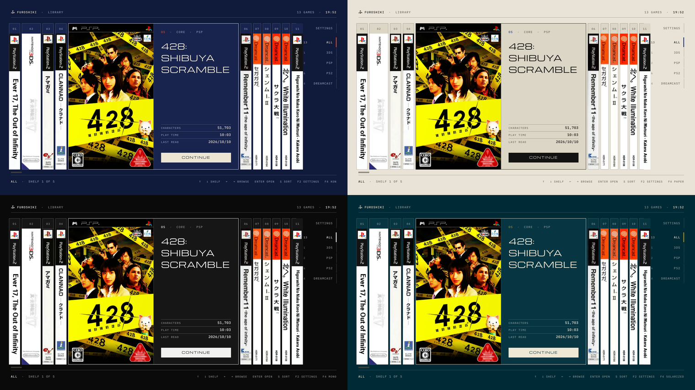
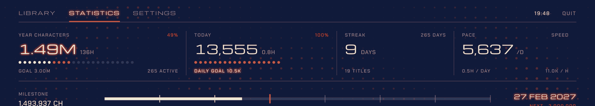
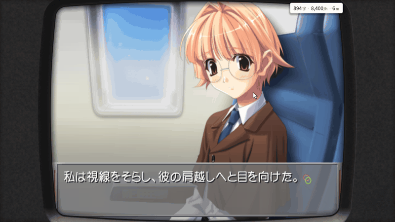
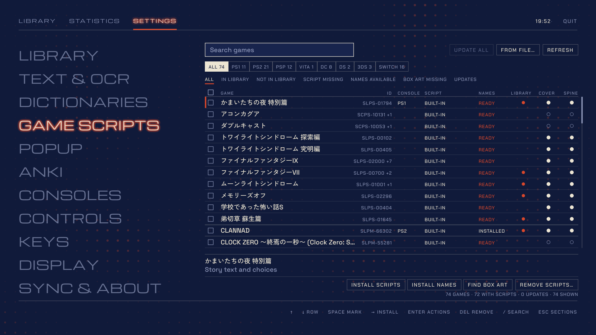
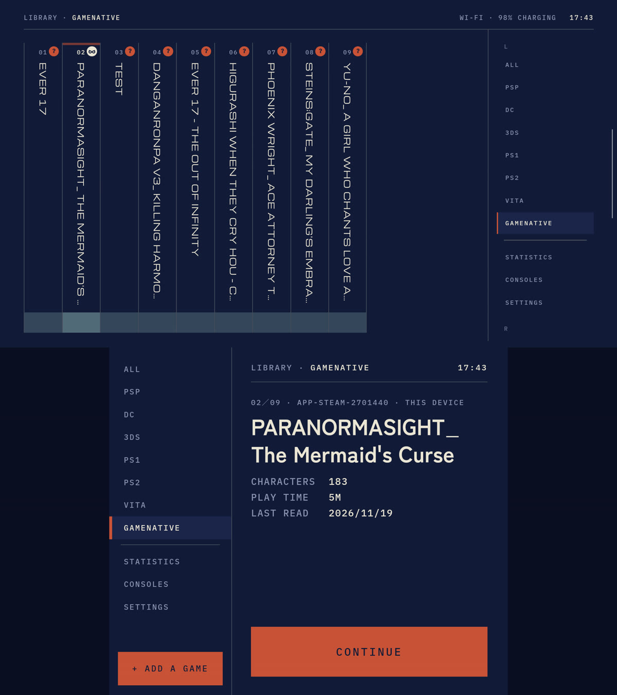

<p align="center"></p>

<h1 align="center">Furoshiki</h1>

<p align="center"><b>A Japanese game launcher for Windows, Linux, and Android with built-in dictionary lookups and Anki sentence mining.</b><br>
Look up words directly in your games and send cards to Anki, even from the couch with a controller.</p>

<p align="center"><b>Latest releases:</b>
<a href="../../releases/download/v0.4.0.1/Furoshiki-0.4.0.1-android.apk">Android 0.4.0.1</a> ·
<a href="../../releases/download/v0.4.0.1/Furoshiki-0.4.0.1-windows.zip">Windows 0.4.0.1</a> ·
<a href="../../releases/download/v0.4.0.1/Furoshiki-0.4.0.1-linux.tar.gz">Linux 0.4.0.1</a> ·
<a href="../../releases/download/v0.4.0.1/Furoshiki-ocr-helper.zip">OCR helper (Windows)</a> ·
<a href="../../releases">all releases</a></p>

<p align="center"></p>

<p align="center"><sub>CLANNAD (PS2) on the desktop with the Kon popup at 80% opacity and blur, showing Jitendex, 明鏡, 大辞泉, frequency badges, and a pitch accent graph from Kanjium (all dictionaries are imported by the user).</sub></p>

Furoshiki combines your Japanese game library, built-in console emulators (seven cores on Android,
six on Windows and Linux), and reading tools in a single app. While you play, you can look up words
right on the game screen and send the sentence, screenshot, and line audio straight to Anki, with
no separate texthooker window or copy-pasting required.

Game text is captured in one of three ways:

| Method | How it works | Availability |
| --- | --- | --- |
| **Game script** | Reads exact text and character positions straight from emulator memory so you can point at or tap the game's own text. | [53 games](#supported-games), Windows & Android |
| **OCR** | Reads text directly from the game image. Works with any game, with occasional OCR errors. | Windows & Android |
| **Text hook / external lines** | Captures exact text from PC games (or a WebSocket/clipboard feed) into a lookup bar at the edge of the screen. | Windows |

## Contents

**Overview**
- [Made for a controller](#made-for-a-controller)
- [Consoles](#consoles)
- [Download](#download)
- [Reading a game](#reading-a-game)
- [Supported games](#supported-games)
- [Adding a game](#adding-a-game)
- [Help](#help) · [Building from source](#building-from-source) · [Licence](#licence)

**Desktop (Windows and Linux)**
- [Setting up on Windows](#setting-up-on-windows)
- [Reading with a controller](#reading-with-a-controller)
- [Games without a script (PC games, texthookers, clipboard)](#on-windows)
- [OCR on Windows](#ocr-on-windows)
- [Library and themes](#library-and-themes)
- [Statistics](#statistics)
- [Display and video](#display-and-video)
- [Settings](#settings)

**Android**
- [Setting up on Android](#setting-up-on-android)
- [OCR on Android](#ocr-on-android)
- [On Android (touch, controller, and in-game menu)](#on-android)
- [Dual-screen handhelds](#dual-screen-handhelds)
- [GameNative and other apps](#gamenative-and-other-apps)

## Made for a controller

Furoshiki works from a sofa or handheld with just a controller. Library browsing, statistics,
settings, in-game menus, dictionary popups, and Anki card creation all work without a keyboard or
mouse (mouse and keyboard work everywhere too).

- Plug in or pair an Xbox, PlayStation, Switch, 8BitDo, or Steam Controller. On first use,
  Furoshiki asks you to press the button marked A so it knows your controller's face-button layout
  and displays matching prompts everywhere.
- The same setup flow binds your reading shortcuts (backlog, pause reading timer, pause game, Quick
  menu, create card), flags conflicts, and suggests free buttons.
- While a popup is open, controller input goes to the popup instead of the game. Use the D-pad to
  move between entries, shoulder buttons to switch tabs (*Words*, *Grammar*, *Kanji*, *Names*), and
  the top or right face buttons to add a card without or with audio. Closing the popup returns
  control to the game.
- On the desktop, tap `Select` in-game to place a cursor on the first word in the line that isn't
  in Anki yet. Step word by word with the D-pad, jump between unknown words with the bumpers, and
  advance dialogue with the bottom face button. See
  [Reading with a controller](#reading-with-a-controller).
- For pointer control when you want it, the Steam Controller trackpad works out of the box, any
  button can be bound to *Pointer (hold)*, and on the AYN Thor the lower screen acts as a trackpad.
  Using the pointer exits controller reading mode automatically.

## Consoles

| Console | Emulator | Windows | Android |
| --- | --- | --- | --- |
| PlayStation | [DuckStation](https://github.com/stenzek/duckstation) | Yes | Yes |
| PlayStation 2 | [PCSX2](https://github.com/PCSX2/pcsx2) ([ARMSX2](https://github.com/ARMSX2/ARMSX2) on Android) | Yes | Yes |
| PSP | [PPSSPP](https://github.com/hrydgard/ppsspp) | Yes | Yes |
| Dreamcast | [Flycast](https://github.com/flyinghead/flycast) | Yes | Yes |
| Nintendo 3DS | [Azahar](https://github.com/azahar-emu/azahar) | Yes | Yes |
| PS Vita | [Vita3K](https://github.com/Vita3K/Vita3K) | Yes | Yes |
| Nintendo DS | [melonDS](https://github.com/melonDS-emu/melonDS) | Not yet | Yes |

Emulators are built in as cores (similar to RetroArch), so there's nothing extra to install. Core
and video settings can be configured globally, per console, or per game.

## Download

Release **0.4.0.1** includes Windows, Android, Linux, and the optional Windows OCR helper:

| File | Platform | Notes |
| --- | --- | --- |
| [Furoshiki-0.4.0.1-windows.zip](../../releases/download/v0.4.0.1/Furoshiki-0.4.0.1-windows.zip) | Windows 10/11 (64-bit) | Extract anywhere and run `Furoshiki.exe`. |
| [Furoshiki-0.4.0.1-linux.tar.gz](../../releases/download/v0.4.0.1/Furoshiki-0.4.0.1-linux.tar.gz) | Linux (64-bit, glibc 2.38+) | Extract anywhere and run `Furoshiki/reader-home`. Requires X11 or Xwayland, OpenGL and Vulkan drivers, and a Japanese font. |
| [Furoshiki-0.4.0.1-android.apk](../../releases/download/v0.4.0.1/Furoshiki-0.4.0.1-android.apk) | Android 10+ (arm64) | Sideload the APK and allow installs from your browser or file manager when prompted. |
| [Furoshiki-ocr-helper.zip](../../releases/download/v0.4.0.1/Furoshiki-ocr-helper.zip) | Windows (optional) | Only needed for OCR on Windows. See [OCR on Windows](#ocr-on-windows). |

- **Windows dependencies:** The PS2 and Vita cores require the
  [Microsoft Visual C++ Redistributable (x64)](https://aka.ms/vs/17/release/vc_redist.x64.exe).
  The dictionary popup uses Microsoft WebView2 (preinstalled on Windows 11 and updated Windows 10;
  falls back to a simpler popup if absent).
- **Linux:** Settings, dictionaries, saves, and BIOS files live in `~/.local/share/Furoshiki`
  (place console BIOS files under `program/consoles/<console>/system`).

No games, BIOS, or firmware files are included. Supply your own dumps along with the system files
below.

## Setting up on Windows

1. Launch `Furoshiki.exe`. Because the binary isn't code-signed, Windows SmartScreen may warn you
   (*More info* › *Run anyway*). First launch opens a 3-step Setup wizard (all steps can be
   skipped and revisited later under Settings › About › Setup).
2. Download [Jitendex](https://jitendex.org) (39 MB) automatically or import your own Yomitan
   `.zip` dictionaries (individual files or a whole folder). At least one dictionary is required
   for lookups; manage them anytime under Settings › Dictionaries.
3. Point Furoshiki to your game folders, or add them later via **Add game** at the end of the
   shelf › *Disc or file*. Place required BIOS or firmware files in the folders below.
4. For optional Anki mining, open Anki with
   [AnkiConnect](https://ankiweb.net/shared/info/2055492159) installed. Furoshiki selects your
   mining deck (or first non-Default deck) and its primary note type, mapping recognized field
   names automatically. Adjust anytime under Settings › Anki › Anki setup.
5. Install game scripts under Settings › Game scripts (or from the in-game Quick menu with `F1` or
   right-click › *Game scripts…*), then restart the game.

| Console | Required files | Folder in `%LOCALAPPDATA%\Furoshiki` |
| --- | --- | --- |
| PlayStation | BIOS (e.g. `SCPH-5500.bin`) | `program\consoles\ps1\system` |
| PlayStation 2 | BIOS | `program\consoles\ps2\system` |
| PSP | None | — |
| Dreamcast | None (`dc_boot.bin` optional) | `program\consoles\dc\system\dc` |
| Nintendo 3DS | Decrypted games (`aes_keys.txt` only if required by a game) | `program\consoles\3ds\system` |
| PS Vita | Firmware (`PSVUPDAT.PUP`, plus `PSP2UPDAT.PUP` if available) | `program\consoles\psvita\system` |

## Setting up on Android

1. Install the APK, open Furoshiki, and grant *Allow file access* so it can scan your games.
2. Choose *Add games folder* during Setup (a top-level `Games` folder on internal storage or SD
   card is detected automatically).
3. Place BIOS/firmware files in `Games/BIOS/PS1`, `Games/BIOS/PS2`, and `Games/BIOS/Vita` (other
   consoles don't need them).
4. Place Yomitan `.zip` dictionaries in `Games/Dictionaries`; they're imported on the next launch.
5. Install [AnkiDroid](https://github.com/ankidroid/Anki-Android) for Anki mining. Furoshiki
   requests permission once and auto-configures your mining deck and note type just like Windows.

Supported game scripts and box art are downloaded automatically once games are found. You can
inspect each console's scripts under Settings › Library › Game scripts.

## Reading a game

Hover or click a word on the desktop (or tap it on Android) to open a dictionary popup with
automatic deinflection. Import your own Yomitan `.zip` dictionaries for definitions, frequency
rankings, pitch accents (such as Kanjium), grammar, and per-character kanji entries (such as
KANJIDIC); none of those dictionaries are bundled.

Supported games also have character names dictionaries built from [VNDB](https://vndb.org),
prioritized ahead of general dictionaries. Hovering a character's name opens a card with their
portrait, full name, reading, role, and description.

<p align="center"></p>

<p align="center"><sub>A character name card on the <i>Names</i> tab in CLANNAD (PS2) on the desktop.</sub></p>

Each Anki card includes the word, full sentence, screenshot, and line audio (optionally trimmed to
voice). On Android, card buttons are inside the popup; on the desktop, you can use the popup
buttons or these shortcuts:

| Key | Action |
| --- | --- |
| `Ctrl+D` | Add sentence card |
| `Ctrl+W` | Add word-only card |
| `Ctrl+Z` | Undo last card |
| `Ctrl+H` | Open backlog |
| `Ctrl+G` | Pause game |
| `Ctrl+T` | Pause reading timer |
| `Ctrl+N` | Skip to next choice |
| `F1` / Right-click | Quick menu |
| `Esc` | Game menu |
| `F2` | Settings |

The backlog stores every line read in the session (with speaker names when available) and lets you
create multi-line cards. Furoshiki also tracks characters read, play time, and reading speed
(characters per hour) locally per title.

<p align="center"></p>

<p align="center"><sub>Game detail page on the desktop showing reading stats and character names.</sub></p>

For pointer control on a gamepad, the Steam Controller trackpad works automatically; on other
controllers, bind any button to *Pointer (hold)* under Settings › Controls › Button mapping so the
analog sticks move the cursor while held.

### Reading with a controller

<p align="center"></p>

<p align="center"><sub>Pointer-free controller reading on the desktop in CLANNAD (PS2): stepping word by word with the D-pad and advancing dialogue with <code>A</code>.</sub></p>

On the desktop (Windows and Linux), you can read without a pointer at all. Tap `Select` in-game to
drop a cursor onto the first word in the current line that isn't already in Anki (or the first word
of the line) and open its popup:

| Button | Action |
| --- | --- |
| D-pad Left / Right | Previous / next word (hold to repeat) |
| D-pad Up / Down | Line above / below (swapped in vertical text) |
| `LB` / `RB` | Previous / next word not in Anki |
| Right stick Left / Right | Shorten / lengthen word selection by one character |
| Right stick Up / Down | Scroll popup |
| `LT` / `RT` | Previous / next popup tab (*Words*, *Grammar*, *Kanji*, *Names*) |
| `A` | Advance dialogue (sends console confirm; cursor moves to the new line) |
| `Y` | Add card for the word |
| `B` | Add card with line audio |
| `X` | Focus popup to pick another entry, tab, or kanji (`X` or `A` returns to text) |
| `Select` | Exit controller reading |

*Button labels above use Xbox layout by position (`A` bottom, `B` right, `X` left, `Y` top); on
PlayStation or Nintendo pads, on-screen prompts match your controller.*

When you switch to the *Kanji* tab with `RT` and focus the popup with `X`, D-pad Left and Right
step through each kanji in the selected word. Per-character kanji entries require an imported
dictionary with a kanji bank (such as KANJIDIC).

<p align="center"></p>

<p align="center"><sub>Stepping through 常, 習, and 犯 on the <i>Kanji</i> tab with the D-pad in CLANNAD (PS2) on the desktop (using imported kanji dictionaries including KANJIDIC).</sub></p>

`Start` and the left stick always stay mapped to the game. When a game presents a choice, all
buttons pass through to the game until the next dialogue line. Moving or clicking the mouse exits
controller reading mode immediately. This works in scripted console games as well as OCR-read
console games (though OCR cannot auto-detect choices).

Customize the activation trigger in Settings › Controls › *Start reading with* (`Select`, `L3`,
`R3`, chorded combos like `Select + A` / `L3 + R3` / `LB + RB`, or *Always during dialogue*). You
can also toggle the on-screen *Reading mark* and *Reading hints* there.

## Games without a script

Console games without a script still run normally and can be read with OCR. PC games can be read
with a text hook or OCR.

### On Windows

<p align="center"></p>

Use **Add game** at the end of the shelf to choose a source:

| Option | Use for | Capture method |
| --- | --- | --- |
| **Disc or file** | Console games | Game script, or OCR if no script exists |
| **Game window** | Running PC games | Text hook, or OCR if no hook works |
| **Texthooker or clipboard** | Any other text source | WebSocket texthooker or clipboard |

For PC games, Furoshiki launches the hook backend automatically using
[Agent](https://github.com/0xDC00/agent) scripts, LunaHook, or
[Textractor](https://github.com/Artikash/Textractor) (downloaded on demand when selected; none are
bundled in this repo).

Hooked or streamed lines appear in a lookup bar at the edge of the screen; OCR also supports
in-place lookups over the game window. Anki cards, backlog, and reading stats work the same way.

### OCR on Windows

Windows OCR uses a separate **OCR helper** download because it bundles its own Python runtime and
~1 GB OCR model. Extract `Furoshiki-ocr-helper.zip` into your Furoshiki folder and run
`install.cmd` (no admin rights needed). Furoshiki manages starting and stopping the helper
automatically — see [home/ocr-helper/README.md](home/ocr-helper/README.md) for details.

Supported engines:
- **Local:** [meikiocr](https://github.com/rtr46/meikiocr) (default), `OneOCR`, `Chrome Screen AI`
- **Cloud:** `Google Lens` (sends cropped text regions to Google)

To enable OCR on a console game, open the Game menu (`Esc`) › *Use OCR for this game* › *Set text
area…*. You can configure multiple regions, including on-demand regions triggered with
`Ctrl+Shift+R` for menus or status screens.

### OCR on Android

<p align="center"></p>

Android OCR works out of the box with no extra download, running `meikiocr` locally on-device.
`Google Lens` is also available (sends cropped text regions to Google) under Settings › Reading ›
OCR engine.

## Library and themes

<p align="center"></p>

<p align="center"><sub>Browsing the library shelf on the desktop in the Nocturne theme.</sub></p>

Games appear as box spines on a shelf. Selecting a spine opens its cover, reading totals, recent
activity, and a launch button. Press `Enter` to open the full detail page, and `Enter` again to
launch. Switch between the *Spine shelf*, *Case stage*, and *Cover flow* library layouts under
Settings › Display.

On the desktop, press `F` on a game to fetch box art (Steam art for Steam titles,
[VNDB](https://vndb.org) cover and spine scans for others). Art is stored in
`%LOCALAPPDATA%\Furoshiki\program\art` on Windows (`~/.local/share/Furoshiki/program/art` on Linux)
as `<ID>.cover.jpg` and `<ID>.spine.jpg` using the ID shown on the game's page, so you can drop in
custom images anytime. Games without a spine scan get a generated console-styled spine. On Android,
covers are fetched automatically.

Press `F4` to cycle through the five built-in themes: **Mono**, **Paper**, **Kon**, **Solarized**,
and **Nocturne**.

<p align="center"></p>

<p align="center"><sub>The library shelf in the Nocturne theme on the desktop.</sub></p>

<p align="center"></p>

## Statistics

The top-level *Statistics* tab (switchable with `Q` / `E`, `LB` / `RB`, or by clicking the top bar;
optional under Settings › Display) tracks your local reading history at a glance. It shows yearly
and daily character totals with goal bars, your current streak, reading pace, a milestone ruler
with an estimated target date, a 52-week activity dot map and daily waveform, a characters arc
(switchable between *Week*, *Month*, *Year*, and *All time*), and your top reading days.

<p align="center"></p>

<p align="center"><sub>The Statistics tab on the desktop in the Nocturne theme (sample reading history).</sub></p>

Select either goal and press confirm (or click it) to open an inline soroban abacus for setting
your daily or yearly character target. Move between rods with Left and Right, slide beads with Up
and Down or the pointer, and confirm to save. The goal bars and percentages update as you slide
each bead.

<p align="center"></p>

<p align="center"><sub>Setting the daily character goal on the inline soroban on the desktop in the Kon theme.</sub></p>

## Display and video

- A CRT filter is available on every console except PS Vita, with presets and sliders for
  scanlines, phosphor mask, and screen curvature. On Windows HDR displays, lit phosphor highlights
  can exceed SDR white on Dreamcast, PSP, and PS2.
- Resolution scaling and per-core graphics options can be set globally, per console, or per game.

<p align="center"></p>

<p align="center"><sub>Remember11 (PS2) on Windows with the optional CRT filter enabled.</sub></p>

## Settings

Press `F2` (or choose *Settings* in the top bar) to open Settings on the desktop. Each section
shows common options first with advanced rows behind *More*. Press `/` to search by name and
`Backspace` to reset a row. Every page works with keyboard, mouse, or controller.

Sections: *Library*, *Text & OCR*, *Dictionaries*, *Game scripts*, *Popup*, *Anki*, *Consoles*,
*Controls*, *Keys*, *Display*, and *About*.

Under *Dictionaries*, you can import individual Yomitan `.zip` files or an entire folder at once,
filter by kind (*Words*, *Grammar*, *Frequency*, *Pitch*, *Names*), reorder dictionaries, and
toggle them on or off.

<p align="center"></p>

<p align="center"><sub>Importing a folder of Yomitan dictionaries under Settings › Dictionaries on the desktop.</sub></p>

Under *Game scripts*, you can browse every supported game by console, see which titles have
scripts, character names dictionaries, covers, and spines installed, and install or update them
without updating the app.

<p align="center"></p>

<p align="center"><sub>Settings › Game scripts on the desktop in the Kon theme.</sub></p>

The *Popup* section includes multiple themes, an *Opacity* slider, *Fit height to entry*, and a
popup editor with custom CSS support and a live preview.

<p align="center"></p>

## On Android

Furoshiki on Android supports both touch and controller play, with virtual on-screen controls when
no physical pad is present and home-screen game shortcuts.

The in-game menu provides save states, fast forward, and skip to next choice:

<p align="center"></p>

### Dual-screen handhelds

The screenshots below are from an AYN Thor. The library shelf runs on the top display (one page
per console), while the lower display shows the selected game's stats and launch button:

<p align="center"></p>

<p align="center"><sub>A checkmark on a spine indicates a game script is available.</sub></p>

In-game, the lower display acts as your lookup surface (or the console's bottom screen for 3DS and
DS games), with two lookup modes:

- **Trackpad mode:** Move a pointer over the upper screen to look up words directly on the game.

<p align="center"></p>

- **Text panel mode:** Displays the current sentence below the trackpad so you can tap words and
  read definitions on the lower screen without covering the game.

<p align="center"></p>

Quick buttons along the bottom provide **Pause**, **Pause timer**, **Backlog**, and **Menu**. In
the popup, `+` adds a card and the speaker icon adds a card with line audio.

### GameNative and other apps

[GameNative](https://github.com/utkarshdalal/GameNative) runs Windows games from Steam and other
stores on Android. Furoshiki can launch and read GameNative titles — or games in any other Android
app — via screen-capture OCR, showing popups over the game or in the lower-screen text panel. Use
**Text area** to crop OCR to the dialogue box if other UI is on screen.

<p align="center"></p>

<p align="center"><sub>Glasses on a spine indicate OCR is configured; a question mark means OCR isn't set up yet.</sub></p>

To integrate GameNative:

1. In GameNative, enable Settings › Interface › Frontend Sync and pick a folder (e.g.
   `Games/GameNative`).
2. Select that same folder in Furoshiki during Setup or via Settings › Library › *Add GameNative
   folder*.

To add a game from any other app, use **Add game** › *Add game from another app*, pick the app,
and enter a title.

## Supported games

Each game script is a small Lua file targeting a specific Japanese release (check the ID below).
Scripts live in [furoshiki-scripts](https://github.com/sommepo/furoshiki-scripts), organized by
console and game; Furoshiki downloads and verifies them automatically before installing.

<details><summary><b>PlayStation</b> (11 games)</summary>

| Game | Japanese title | ID | What is read |
| --- | --- | --- | --- |
| Kamaitachi no Yoru | かまいたちの夜 特別篇 | SLPS-01794 | Story text and choices |
| Double Cast | ダブルキャスト | SCPS-10053, SCPS-10054 | Film subtitles and choices |
| Aconcagua | アコンカグア | SCPS-10131, SCPS-10132 | Message windows |
| Gakkou de Atta Kowai Hanashi S | 学校であった怖い話S | SLPS-00404 | Story text and choices |
| Otogirisou Sosei-hen | 弟切草 蘇生篇 | SLPS-01645 | Story text and choices |
| Twilight Syndrome: Tansaku-hen | トワイライトシンドローム 探索編 | SLPS-00102 | Message window with speakers |
| Twilight Syndrome: Kyuumei-hen | トワイライトシンドローム 究明編 | SLPS-00405 | Message window with speakers |
| Moonlight Syndrome | ムーンライトシンドローム | SLPS-01001, SLPS-01002 | Text window with speakers |
| Memories Off | メモリーズオフ | SLPS-02296 | Text window with speakers, choices |
| Final Fantasy VII | ファイナルファンタジーVII | SLPS-00700, SLPS-00701, SLPS-00702 | Field message windows, choices |
| Final Fantasy IX | ファイナルファンタジーIX | SLPS-02000 to SLPS-02003, SCPS-45500 to SCPS-45503 | Dialogue windows with speakers, choices |

</details>

<details><summary><b>PlayStation 2</b> (19 games)</summary>

| Game | Japanese title | ID | What is read |
| --- | --- | --- | --- |
| Ever17 | Ever17 -the out of infinity- Premium Edition | SLPM-65421 | Story text with speakers, choices |
| Never7 | Never7 -the end of infinity- | SLPS-25256 | Story text with speakers, choices |
| Remember11 | Remember11 -the age of infinity- | SLPM-65550 | Story text with speakers, choices |
| CLANNAD | CLANNAD | SLPM-66302 | Story text with speakers, choices |
| Higurashi no Naku Koro ni Matsuri | ひぐらしのなく頃に祭 カケラ遊び | SLPM-66913 | Story text with speakers and furigana |
| Amagami | アマガミ | SLPS-25918 | Message window with furigana, choices |
| EVE burst error PLUS | EVE burst error PLUS | SLPM-65320 | Message window |
| Utawarerumono | うたわれるもの 散りゆく者への子守唄 | SLPS-25679 | Message window with speakers |
| Shadow Hearts | シャドウハーツ | SLPS-25041 | Scene and talk windows with speakers |
| Dragon Quest V | ドラゴンクエストV 天空の花嫁 | SLPM-65555 | Message window |
| Silent Hill 2 | サイレントヒル2 | SLPM-65051 | Subtitles |
| Kanon | Kanon | SLPS-20121 | Story text with speakers, choices |
| Persona 3 | ペルソナ3 | SLPM-66445 | Message windows with speakers, choices |
| Persona 4 | ペルソナ4 | SLPM-66978 | Message windows with speakers, choices |
| Shin Megami Tensei III: Nocturne Maniax | 真・女神転生III NOCTURNE マニアクス | SLPM-65462 | Scene and message windows |
| Digital Devil Saga | DIGITAL DEVIL SAGA アバタール・チューナー | SLPM-65597 | Scene and message windows |
| Final Fantasy X International | ファイナルファンタジーX インターナショナル | SLPS-25088 | Message windows with speakers, subtitles, choices |
| Metal Gear Solid 2: Substance | METAL GEAR SOLID 2 SUBSTANCE | SLPM-67002 | Codec conversations, cutscene and radio subtitles |
| Metal Gear Solid 3: Snake Eater | METAL GEAR SOLID 3 SNAKE EATER | SLPM-65790 | Codec conversations, cutscene and radio subtitles |

</details>

<details><summary><b>PSP</b> (10 games)</summary>

| Game | Japanese title | ID | What is read |
| --- | --- | --- | --- |
| Steins;Gate | STEINS;GATE | ULJM05887 | Message window with speakers and furigana, phone mails |
| Chaos;Head Love Chu Chu! | CHAOS;HEAD らぶChu☆Chu! | ULJM05821 | Message window with furigana |
| 428: Shibuya Scramble | 428 ～封鎖された渋谷で～ | ULJS00219 | Story text with furigana, TIPS, choices |
| Danganronpa | ダンガンロンパ 希望の学園と絶望の高校生 | NPJH50372 | Message box with speakers |
| Trails in the Sky FC | 英雄伝説 空の軌跡FC | ULJM05170 | Talk windows with speakers and furigana, choices |
| Tokimeki Memorial Forever with You | ときめきメモリアル forever with you | ULJM05078 | Message window with speakers, choices |
| Grisaia no Kajitsu | グリザイアの果実 -LE FRUIT DE LA GRISAIA- | ULJM06232, ULJM06233 | Message window with speakers, choices |
| Da Capo I&II Plus Situation Portable | D.C.I&II P.S.P. | ULJM05718, ULJM05719 | Message window with speakers and furigana, choices |
| My Merry May with be | My Merry May with be | ULJM05603 | Story text with speakers, choices |
| Dunamis 15 | DUNAMIS15 | ULJM06119 | Message window with speakers and furigana |

</details>

<details><summary><b>Dreamcast</b> (8 games)</summary>

| Game | Japanese title | ID | What is read |
| --- | --- | --- | --- |
| Shenmue II (Windows only for now) | シェンムーII | HDR-0164 | Subtitles |
| What's Shenmue | What's シェンムー 〜湯川(元)専務をさがせ〜 | 6107179 | Subtitles |
| Sakura Taisen | サクラ大戦 | HDR-0072 | Message window, timed choices |
| Segagaga | セガガガ | HDR-0151 | Message window |
| Rent a Hero No.1 | レンタヒーロー No.1 | HDR-0074 | Message window |
| Kita e. White Illumination | 北へ。White Illumination | T14301M | Message window |
| July | July | T35401M | Message window with speakers, choices |
| Ayanami Raising Project | 新世紀エヴァンゲリオン 綾波育成計画 | T46303M | Message window |

</details>

<details><summary><b>Nintendo 3DS</b> (2 games)</summary>

| Game | Japanese title | ID | What is read |
| --- | --- | --- | --- |
| Shin Megami Tensei IV | 真・女神転生IV | 0004000000088A00 | Dialogue, narration and choices |
| Professor Layton vs. Phoenix Wright: Ace Attorney | レイトン教授VS逆転裁判 | 0004000000078B00 | Dialogue with speakers, narration, subtitles, puzzle texts |

</details>

<details><summary><b>Nintendo DS</b> (2 games, Android)</summary>

| Game | Japanese title | ID | What is read |
| --- | --- | --- | --- |
| Wish Room | ウィッシュルーム 天使の記憶 | AWIJ | Message windows with speakers, choices |
| 999: Nine Hours, Nine Persons, Nine Doors | 極限脱出 9時間9人9の扉 | BSKJ | Novel text and talk windows with speakers, escape rooms, choices, file pages |

</details>

<details><summary><b>PS Vita</b> (1 game)</summary>

| Game | Japanese title | ID | What is read |
| --- | --- | --- | --- |
| Trails in the Sky FC Evolution | 英雄伝説 空の軌跡 FC Evolution | PCSG00488 | Talk windows with speakers and furigana |

</details>

## Adding a game

Game scripts live in [sommepo/furoshiki-scripts](https://github.com/sommepo/furoshiki-scripts) and
are designed to be written with a coding agent (Claude Code, Codex, Gemini CLI, etc.) on Windows,
Linux, or macOS. The agent launches the game in Furoshiki, locates its text in memory, writes the
Lua script, and verifies it against the running game.

**Requirements:** Furoshiki 0.3.2+, Python 3.9+, a coding agent, and your own dump of the Japanese
release.

1. Fork [furoshiki-scripts](https://github.com/sommepo/furoshiki-scripts), clone it locally, and
   start your agent inside the repo.
2. Tell the agent which game to add along with the paths to your dump and Furoshiki, for example:
   *"Add support for Steins;Gate on PSP. The game is at `D:\Games\PSP\steins-gate.iso` and
   Furoshiki is in `C:\Furoshiki`."*
3. The agent follows [AGENTS.md](https://github.com/sommepo/furoshiki-scripts/blob/main/AGENTS.md)
   and summarizes what it verified in-game (plus anything it couldn't test).
4. Play through a few scenes to test it. The agent saves the script directly into your local
   scripts folder, which takes precedence over downloaded scripts:
   - Windows: `%LOCALAPPDATA%\Furoshiki\program\reader\profiles`
   - Linux: `~/.local/share/Furoshiki/program/reader/profiles`
   - Android: `Android/data/io.github.sommepo.furoshiki/files/reader/profiles`
5. Have the agent open a pull request. Once merged, anyone can install the script from Settings ›
   Game scripts without updating the app.

To share an unmerged script with someone else, just send them the `.lua` file (and its `.charset`
character table, if it has one) to drop into their scripts folder above.

## Help

Report bugs or ask questions in [Issues](../../issues). Please do not report Furoshiki issues to
upstream emulator projects. Furoshiki is not affiliated with them, or with Sony, Sega, or
Nintendo.

## Building from source

| Folder | Description |
| --- | --- |
| `home/` | Desktop app (Windows and Linux) |
| `android/` | Android app |
| `shared/` | Shared lookup and Anki card code |
| `home/ocr-helper/` | Python OCR helper (`package.sh` builds its zip) |
| `cores/` | Core interface between Furoshiki and emulators |
| `station/`, `pcsx2/`, `armsx2/`, `ppsspp/`, `flycast/`, `azahar/`, `vita3k/`, `melonds/` | Emulator forks, cores, and game scripts |

All build scripts run on Linux. Each emulator's `tools/reader/env.sh` lists the expected compilers
and toolchains.

1. Fetch an emulator's submodules:
   ```bash
   git submodule update --init --recursive -- <folder>
   ```
2. Build its core: `<emulator>/tools/reader/build-core-windows.sh`, `build-core-android.sh`, or
   `build-core.sh` (Linux).
3. Build Furoshiki:
   - **Windows:** `HOME_PUBLIC=1 home/tools/build-windows.sh`, then `HOME_PUBLIC=1 home/tools/package-windows.sh`
   - **Android:** `android/tools/build.sh`

## Licence

Furoshiki and its cores are free software under the
[GNU General Public License, version 3](COPYING) (also included in `home/`, `cores/`, and
`shared/`). Each bundled emulator retains its own licence and notices in its folder.
[NOTICES.md](NOTICES.md) lists all package attributions and explains why Flycast (whose upstream
`LICENSE` is GPLv2) is distributed here under GPLv3.
Character name data comes from [VNDB](https://vndb.org) under the Open Database License
([titles/LICENSE](titles/LICENSE)). On Android, third-party notices and full licence texts are
available under Settings › About › Open-source licences.
