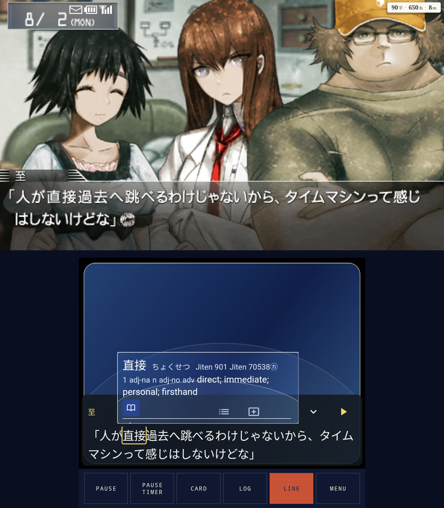
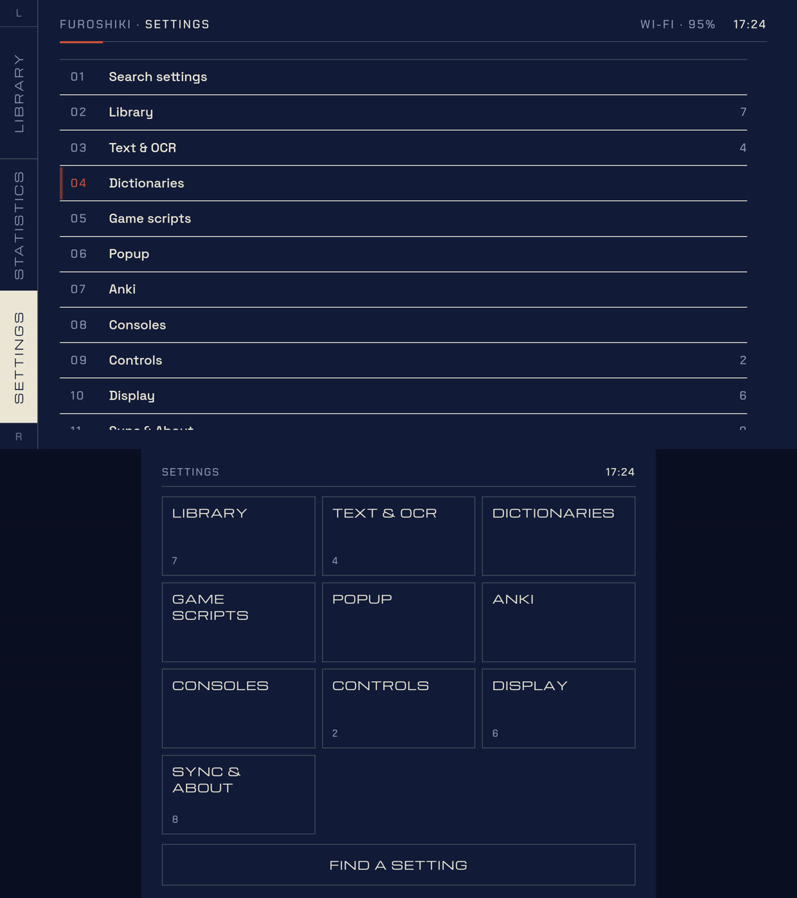

# Android, dual-screen handhelds, OCR, and GameNative

[Back to README](../README.md)

## Touch, controller, and in-game menu

Furoshiki on Android supports both touch and controller play, with virtual on-screen controls when no physical pad is present and home-screen game shortcuts. The in-game menu provides save states, fast forward, and skip to next choice.

## Dual-screen handhelds

On dual-screen handhelds like the AYN Thor, the top display runs the game (or the library, statistics, and settings), while the lower display acts as your lookup and control surface (or the console's bottom screen for 3DS and DS games).

In-game, the lower display offers two lookup modes:

- **Trackpad mode:** Move a pointer over the upper screen to look up words directly on the game. Use `L1` and `R1` to switch popup tabs (*Words*, *Grammar*, *Kanji*, *Names*).
- **Text panel mode:** Displays the current sentence below the trackpad so you can tap words and read definitions on the lower screen without covering the game.

Text panel mode on the AYN Thor showing the sentence and dictionary popup on the lower display.

Statistics and Settings use the lower display the same way: the top shows the page, and the lower display holds the controls you change with your thumbs (the period and goal keys, or the sections of Settings):

Quick buttons along the bottom provide **Pause**, **Pause timer**, **Backlog**, and **Menu**. In the popup, `+` adds a card and the speaker icon adds a card with line audio.

## OCR on Android

Android OCR works out of the box with no extra download, running [meikiocr](https://github.com/rtr46/meikiocr) locally on-device. `Google Lens` is also available (sends cropped text regions to Google) under **Settings › Reading › OCR engine**.

Use **Text area** to crop OCR to the dialogue box if other UI is on screen.

## GameNative and other apps

[GameNative](https://github.com/utkarshdalal/GameNative) runs Windows games from Steam and other stores on Android. Furoshiki can launch and read GameNative titles, or games in any other Android app, via screen-capture OCR, showing popups over the game or in the lower-screen text panel.

To integrate GameNative:

1. In GameNative, enable **Settings › Interface › Frontend Sync** and pick a folder (for example `Games/GameNative`).
2. Select that same folder in Furoshiki during Setup or via **Settings › Library › Add GameNative folder**.

To add a game from any other app, use **Add game › Add game from another app**, pick the app, and enter a title.
