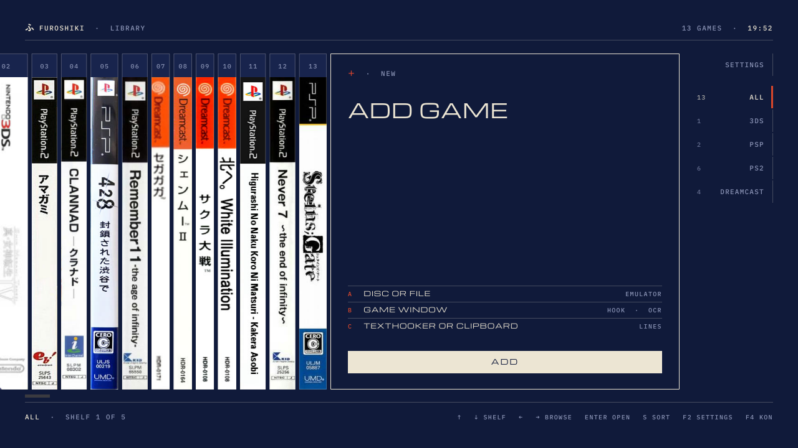
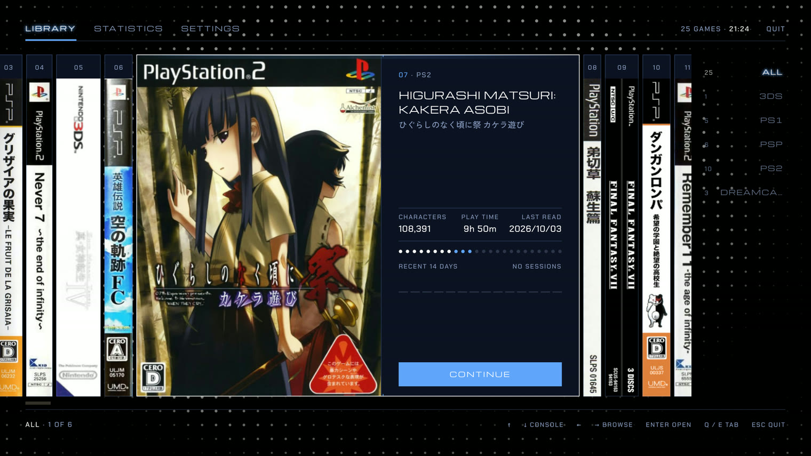
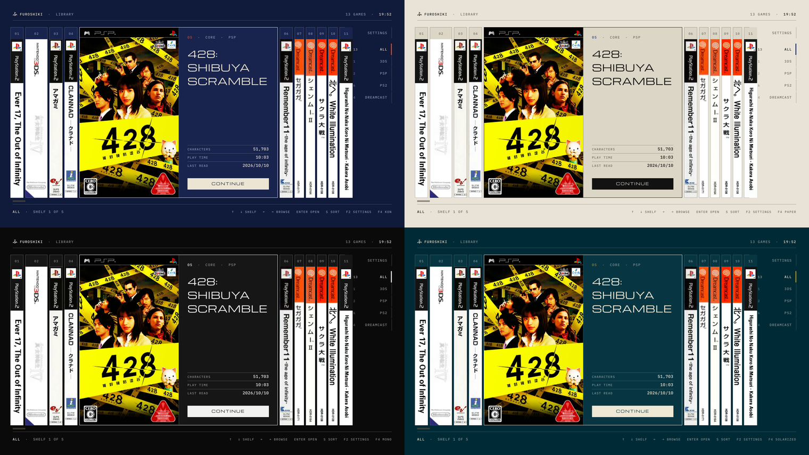
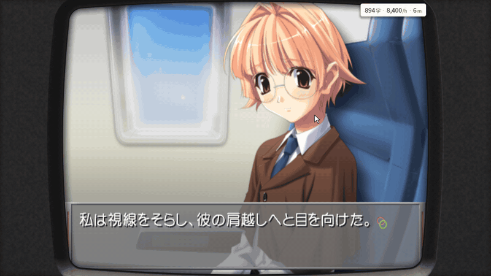
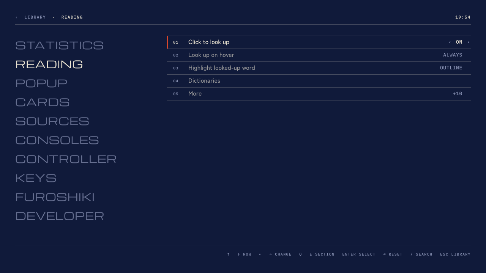

# Desktop features, OCR, themes, and settings

[Back to README](../README.md)

## Games without a script (Windows)

Console games without a script still run normally and can be read with OCR. PC games can be read with a text hook or OCR.

Use **Add game** at the end of the shelf to choose a source:

| Option | Use for | Capture method |
| --- | --- | --- |
| **Disc or file** | Console games | Game script, or OCR if no script exists |
| **Game window** | Running PC games | Text hook, or OCR if no hook works |
| **Texthooker or clipboard** | Any other text source | WebSocket texthooker or clipboard |

For PC games, Furoshiki launches the hook backend automatically using [Agent](https://github.com/0xDC00/agent) scripts, LunaHook, or [Textractor](https://github.com/Artikash/Textractor) (downloaded on demand when selected; none are bundled in this repo).

Hooked or streamed lines appear in a lookup bar at the edge of the screen; OCR also supports in-place lookups over the game window. Anki cards, backlog, and reading stats work the same way.

## OCR on Windows

Windows OCR uses a separate **OCR helper** download because it bundles its own Python runtime and ~1 GB OCR model. Extract `Furoshiki-ocr-helper.zip` into your Furoshiki folder and run `install.cmd` (no admin rights needed). Furoshiki manages starting and stopping the helper automatically; see [home/ocr-helper/README.md](../home/ocr-helper/README.md) for details.

Supported engines:
- **Local:** [meikiocr](https://github.com/rtr46/meikiocr) (default), `OneOCR`, `Chrome Screen AI`
- **Cloud:** `Google Lens` (sends cropped text regions to Google)

To enable OCR on a console game, open the Game menu (`Esc`) › *Use OCR for this game* › *Set text area…*. You can configure multiple regions, including on-demand regions triggered with `Ctrl+Shift+R` for menus or status screens.

## Library and themes

Games appear as box spines on a shelf. Selecting a spine opens its cover, reading totals, recent activity, and a launch button. Press `Enter` to open the full detail page, and `Enter` again to launch. Switch between the *Spine shelf*, *Case stage*, and *Cover flow* library layouts under Settings › Display.

On the desktop, press `F` on a game to fetch box art (Steam art for Steam titles, [VNDB](https://vndb.org) cover and spine scans for others). Art is stored in `%LOCALAPPDATA%\Furoshiki\program\art` on Windows (`~/.local/share/Furoshiki/program/art` on Linux) as `<ID>.cover.jpg` and `<ID>.spine.jpg` using the ID shown on the game's page, so you can drop in custom images anytime. Games without a spine scan get a generated console-styled spine. On Android, covers are fetched automatically.

Press `F4` to cycle through the five built-in themes: **Mono**, **Paper**, **Kon**, **Solarized**, and **Nocturne**.

The library shelf in the Nocturne theme on the desktop.

## Display and video

- A CRT filter is available on every console except PS Vita, with presets and sliders for scanlines, phosphor mask, and screen curvature. On Windows HDR displays, lit phosphor highlights can exceed SDR white on Dreamcast, PSP, and PS2.
- Resolution scaling and per-core graphics options can be set globally, per console, or per game.

Remember11 (PS2) on Windows with the optional CRT filter enabled.

## Settings

Press `F2` (or choose *Settings* in the top bar) to open Settings on the desktop. Each section shows common options first with advanced rows behind *More*. Press `/` to search by name and `Backspace` to reset a row. Every page works with keyboard, mouse, or controller.

Sections: *Library*, *Text & OCR*, *Dictionaries*, *Game scripts*, *Popup*, *Anki*, *Consoles*, *Controls*, *Keys*, *Display*, and *About*.

The *Popup* section includes multiple themes, an *Opacity* slider, *Fit height to entry*, and a popup editor with custom CSS support and a live preview.

