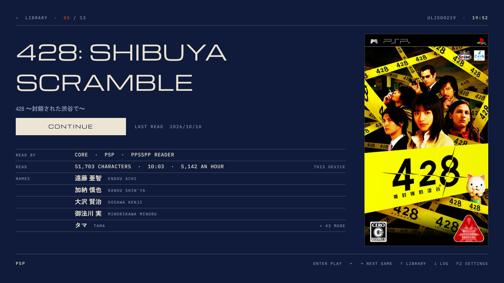

# Reading, popups, and controller controls

[Back to README](../README.md)

## Lookups, names, and Anki cards

Hover or click a word on the desktop (or tap it on Android) to open a dictionary popup with automatic deinflection. Import your own Yomitan `.zip` dictionaries for definitions, frequency rankings, pitch accents (such as Kanjium), grammar, and per-character kanji entries (such as KANJIDIC); none of those dictionaries are bundled.

Supported games also have character names dictionaries built from [VNDB](https://vndb.org), prioritized ahead of general dictionaries. Hovering a character's name opens a card with their portrait, full name, reading, role, and description.

Each Anki card includes the word, full sentence, screenshot, and line audio (optionally trimmed to voice). On Android, card buttons are inside the popup; on the desktop, you can use the popup buttons or these keyboard shortcuts:

| Key | Action |
| --- | --- |
| `Ctrl+D` | Add sentence card |
| `Ctrl+W` | Add word-only card |
| `Ctrl+Z` | Undo last card |
| `Ctrl+H` | Open backlog |
| `Ctrl+G` | Pause game |
| `Ctrl+T` | Pause reading timer |
| `Ctrl+N` | Skip to next choice |
| `F1` / Right-click | Quick menu |
| `Esc` | Game menu |
| `F2` | Settings |

The backlog stores every line read in the session (with speaker names when available), lets you look up words in past lines, toggle whether a line is counted, and create multi-line cards. Furoshiki also tracks characters read, play time, and reading speed (characters per hour) locally per title.

Game detail page on the desktop showing reading stats and character names.

## Controller setup and reading mode

Plug in or pair an Xbox, PlayStation, Switch, 8BitDo, or Steam Controller. On first use, Furoshiki asks you to press the button marked A so it knows your controller's face-button layout and displays matching prompts everywhere. The same setup flow binds your reading shortcuts (backlog, pause reading timer, pause game, Quick menu, create card), flags conflicts, and suggests free buttons.

For pointer control on a gamepad, the Steam Controller trackpad works automatically; on other controllers, bind any button to *Pointer (hold)* under Settings › Controls › Button mapping so the analog sticks move the cursor while held.

On the desktop (Windows and Linux), you can also read without a pointer at all. Tap `Select` in-game to drop a cursor onto the first word in the current line that isn't already in Anki (or the first word of the line) and open its popup:

| Button | Action |
| --- | --- |
| D-pad Left / Right | Previous / next word (hold to repeat) |
| D-pad Up / Down | Line above / below (swapped in vertical text) |
| `LB` / `RB` | Previous / next word not in Anki |
| Right stick Left / Right | Shorten / lengthen word selection by one character |
| Right stick Up / Down | Scroll popup |
| `LT` / `RT` | Previous / next popup tab (*Words*, *Grammar*, *Kanji*, *Names*) |
| `A` | Advance dialogue (sends console confirm; cursor moves to the new line) |
| `Y` | Add card for the word |
| `B` | Add card with line audio |
| `X` | Focus popup to pick another entry, tab, or kanji (`X` or `A` returns to text) |
| `Select` | Exit controller reading |

*Button labels above use Xbox layout by position (`A` bottom, `B` right, `X` left, `Y` top); on PlayStation or Nintendo pads, on-screen prompts match your controller.*

When you switch to the *Kanji* tab with `RT` and focus the popup with `X`, D-pad Left and Right step through each kanji in the selected word. Per-character kanji entries require an imported dictionary with a kanji bank (such as KANJIDIC).

`Start` and the left stick always stay mapped to the game. When a game presents a choice, all buttons pass through to the game until the next dialogue line. Moving or clicking the mouse exits controller reading mode immediately. This works in scripted console games as well as OCR-read console games (though OCR cannot auto-detect choices).

Customize the activation trigger in Settings › Controls › *Start reading with* (`Select`, `L3`, `R3`, chorded combos like `Select + A` / `L3 + R3` / `LB + RB`, or *Always during dialogue*). You can also toggle the on-screen *Reading mark* and *Reading hints* there.
