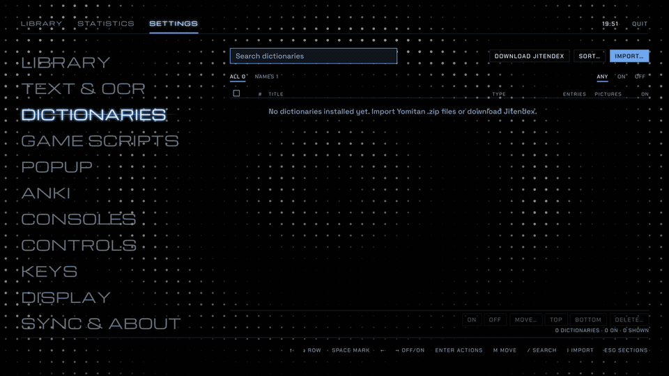

# Setup and installation

[Back to README](../README.md)

## Download

Release **0.4.0.1** includes Windows, Android, Linux, and the optional Windows OCR helper:

| File | Platform | Notes |
| --- | --- | --- |
| [Furoshiki-0.4.0.1-windows.zip](../../../releases/download/v0.4.0.1/Furoshiki-0.4.0.1-windows.zip) | Windows 10/11 (64-bit) | Extract anywhere and run `Furoshiki.exe`. |
| [Furoshiki-0.4.0.1-linux.tar.gz](../../../releases/download/v0.4.0.1/Furoshiki-0.4.0.1-linux.tar.gz) | Linux (64-bit, glibc 2.38+) | Extract anywhere and run `Furoshiki/reader-home`. Requires X11 or Xwayland, OpenGL and Vulkan drivers, and a Japanese font. |
| [Furoshiki-0.4.0.1-android.apk](../../../releases/download/v0.4.0.1/Furoshiki-0.4.0.1-android.apk) | Android 10+ (arm64) | Sideload the APK and allow installs from your browser or file manager when prompted. |
| [Furoshiki-ocr-helper.zip](../../../releases/download/v0.4.0.1/Furoshiki-ocr-helper.zip) | Windows (optional) | Only needed for OCR on Windows. See [Desktop, OCR, and settings](desktop.md#ocr-on-windows). |

- **Windows dependencies:** The PS2 and Vita cores require the [Microsoft Visual C++ Redistributable (x64)](https://aka.ms/vs/17/release/vc_redist.x64.exe). The dictionary popup uses Microsoft WebView2 (preinstalled on Windows 11 and updated Windows 10; falls back to a simpler popup if absent).
- **Linux:** Settings, dictionaries, saves, and BIOS files live in `~/.local/share/Furoshiki` (place console BIOS files under `program/consoles/<console>/system`).

No games, BIOS, or firmware files are included. Supply your own dumps along with the system files below.

## Setting up on Windows (and Linux)

1. Launch `Furoshiki.exe` (or `Furoshiki/reader-home` on Linux). Because the Windows binary isn't code-signed, Windows SmartScreen may warn you (*More info* › *Run anyway*). First launch opens a 3-step Setup wizard (all steps can be skipped and revisited later under Settings › About › Setup).
2. Download [Jitendex](https://jitendex.org) (39 MB) automatically or import your own Yomitan `.zip` dictionaries (individual files or a whole folder). At least one dictionary is required for lookups; manage them anytime under Settings › Dictionaries.
3. Point Furoshiki to your game folders, or add them later via **Add game** at the end of the shelf › *Disc or file*. Place required BIOS or firmware files in the folders below.
4. For optional Anki mining, open Anki with [AnkiConnect](https://ankiweb.net/shared/info/2055492159) installed. Furoshiki selects your mining deck (or first non-Default deck) and its primary note type, mapping recognized field names automatically. Adjust anytime under Settings › Anki › Anki setup.
5. Install game scripts under Settings › Game scripts (or from the in-game Quick menu with `F1` or right-click › *Game scripts…*), then restart the game.

Importing a folder of Yomitan dictionaries under Settings › Dictionaries on the desktop.

| Console | Required files | Folder in `%LOCALAPPDATA%\Furoshiki` (or `~/.local/share/Furoshiki`) |
| --- | --- | --- |
| PlayStation | BIOS (e.g. `SCPH-5500.bin`) | `program/consoles/ps1/system` |
| PlayStation 2 | BIOS | `program/consoles/ps2/system` |
| PSP | None | — |
| Dreamcast | None (`dc_boot.bin` optional) | `program/consoles/dc/system/dc` |
| Nintendo 3DS | Decrypted games (`aes_keys.txt` only if required by a game) | `program/consoles/3ds/system` |
| PS Vita | Firmware (`PSP2UPDAT.PUP`, plus `PSVUPDAT.PUP` if available) | `program/consoles/psvita/system` |

## Setting up on Android

1. Install the APK, open Furoshiki, and grant *Allow file access* so it can scan your games.
2. Choose *Add games folder* during Setup (a top-level `Games` folder on internal storage or SD card is detected automatically).
3. Place BIOS/firmware files in `Games/BIOS/PS1`, `Games/BIOS/PS2`, and `Games/BIOS/Vita` (other consoles don't need them).
4. Place Yomitan `.zip` dictionaries in `Games/Dictionaries`; they're imported on the next launch.
5. Install [AnkiDroid](https://github.com/ankidroid/Anki-Android) for Anki mining. Furoshiki requests permission once and auto-configures your mining deck and note type just like Windows.

Supported game scripts and box art are downloaded automatically once games are found. You can inspect each console's scripts under Settings › Library › Game scripts.

## Sharing statistics across devices

Furoshiki can combine your reading history across Windows, Linux, and Android through any folder you keep in sync yourself (such as [Syncthing](https://syncthing.net/), a network share, or a cloud folder):

1. Create a synced folder (for example `Furoshiki-Stats`) with Syncthing or your preferred sync tool across your devices.
2. On each device, point Furoshiki to that folder under **Settings › Sync & About › Statistics folder** (or place it at `<shared folder>/stats`).

Each device writes only its own JSON file (`<device-id>.json`) and reads every other device's file to merge totals, streaks, and daily activity, so sync tools never hit file-merge conflicts. Your daily, weekly, monthly, and yearly goals are shared in `goals.json` (newest written wins).
